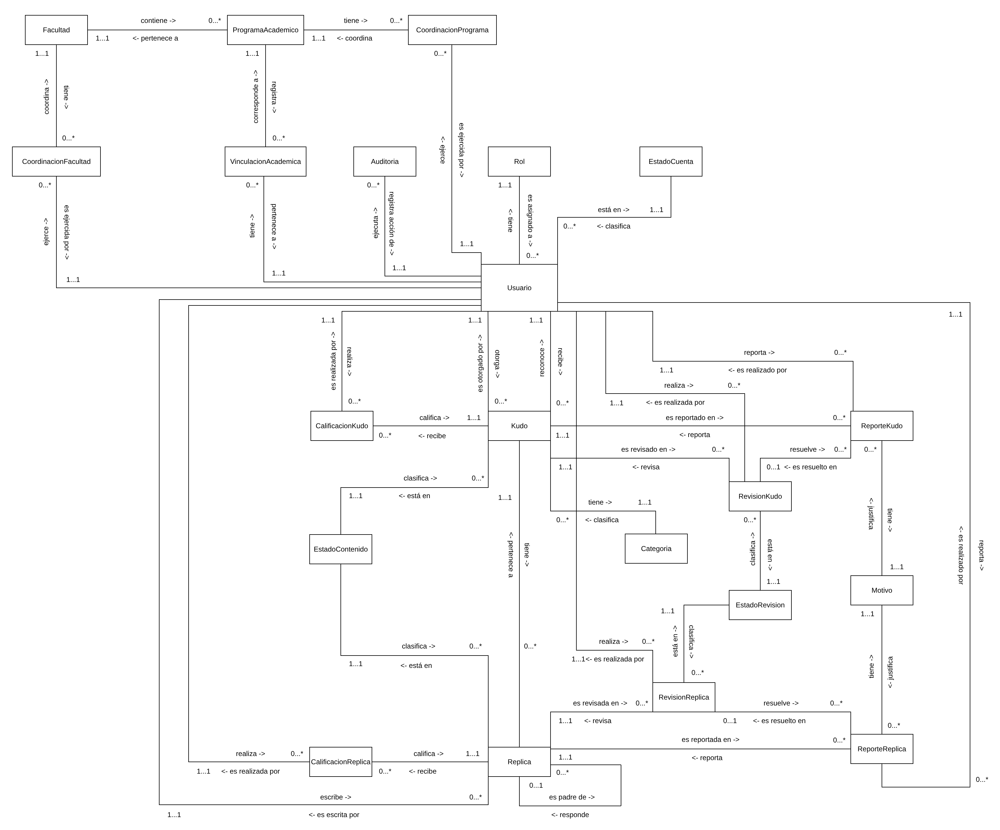
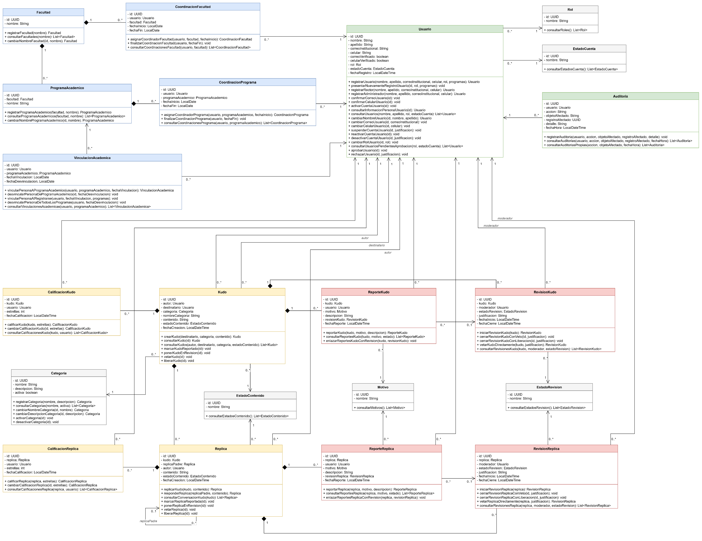
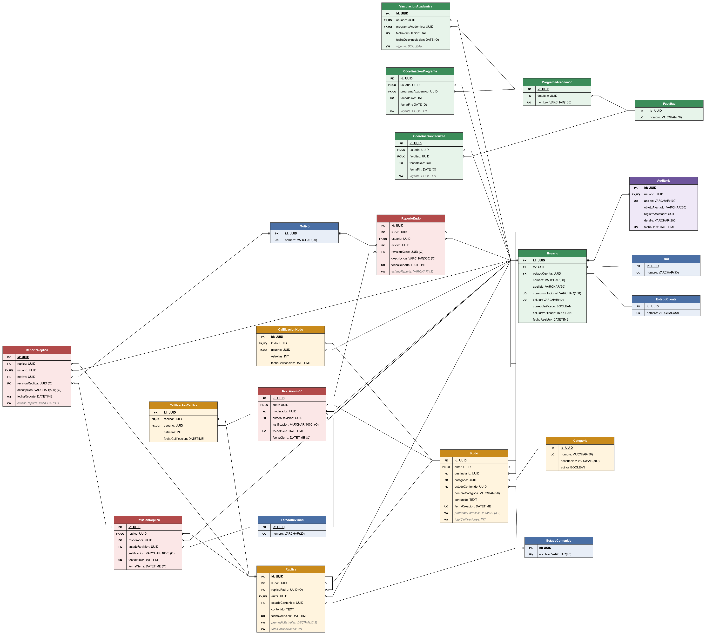

# UCO Kudos

**Plataforma Institucional de Reconocimientos de la Universidad Católica de Oriente**

Proyecto integrador final de la asignatura **Diseño Orientado a Objetos (DOO)** de la Universidad Católica de Oriente, semestre 2026-2.

[](https://sonarcloud.io/summary/new_code?id=Leandro-Gomez-12345_Proyecto-Kudos)
[](https://sonarcloud.io/summary/new_code?id=Leandro-Gomez-12345_Proyecto-Kudos)
[](https://sonarcloud.io/summary/new_code?id=Leandro-Gomez-12345_Proyecto-Kudos)


---

## Tabla de contenido

1. [Descripción del problema](#1-descripción-del-problema)
2. [Propuesta de valor](#2-propuesta-de-valor)
3. [Actores del sistema](#3-actores-del-sistema)
4. [Reglas generales de la plataforma](#4-reglas-generales-de-la-plataforma)
5. [Modelo de dominio](#5-modelo-de-dominio)
6. [Responsabilidades por objeto (event storming)](#6-responsabilidades-por-objeto-event-storming)
7. [Políticas de negocio por objeto](#7-políticas-de-negocio-por-objeto)
8. [Diagrama de clases](#8-diagrama-de-clases)
9. [Modelo relacional](#9-modelo-relacional)
10. [Arquitectura del backend](#10-arquitectura-del-backend)
11. [Transacción de ejemplo: Crear un Kudo](#11-transacción-de-ejemplo-crear-un-kudo)
12. [API REST](#12-api-rest)
13. [Pruebas de la API con Bruno](#13-pruebas-de-la-api-con-bruno)
14. [Seguridad](#14-seguridad)
15. [Calidad del código y análisis estático](#15-calidad-del-código-y-análisis-estático)
16. [Tecnologías](#16-tecnologías)
17. [Cómo ejecutar el proyecto](#17-cómo-ejecutar-el-proyecto)

---

## 1. Descripción del problema

La Universidad Católica de Oriente no cuenta con un sistema centralizado para gestionar los reconocimientos institucionales. Hoy se hacen por:

- Correo electrónico.
- Redes sociales.
- Conversaciones informales.
- Eventos institucionales.

Como consecuencia:

- **No existe trazabilidad** de quién reconoció a quién, ni por qué.
- **No existe historial**: los reconocimientos se pierden con el tiempo.
- **No existen indicadores** sobre la participación de la comunidad.
- **No existe una estrategia institucional unificada** de reconocimiento.

Por eso se desarrolla **UCO Kudos**, una plataforma en la que los integrantes de la comunidad universitaria **publican reconocimientos** (*Kudos*), **conversan** sobre ellos, los **califican**, **reportan** el contenido inapropiado y en la que las autoridades **moderan** el contenido y **auditan** toda la actividad. La plataforma respeta la estructura organizacional oficial: facultades, programas académicos y la cadena de aprobación de cada rol.

## 2. Propuesta de valor

Un **Kudo** es un reconocimiento formal que una persona otorga a otra de la comunidad universitaria por una conducta destacada, un logro académico o institucional, un aporte a la comunidad o un comportamiento alineado con los valores de la UCO.

UCO Kudos busca **conservar la memoria institucional de los reconocimientos**: cada Kudo queda clasificado en una categoría oficial, visible para la comunidad autenticada y con su conversación, sus calificaciones y su historial de moderación. Cada acción queda registrada en la auditoría, de modo que la universidad siempre sabe **quién hizo qué, sobre qué registro y cuándo**.

## 3. Actores del sistema

| Actor | Responsabilidades |
|---|---|
| **Administrador** | Registra al Rector y a otros administradores, gestiona las categorías de los Kudos y confirma los datos de contacto de las cuentas que le corresponden. |
| **Rector** | Aprueba al Coordinador Académico, gestiona categorías, modera el contenido (inicia revisiones, veta o libera Kudos y réplicas) y consulta la auditoría. |
| **Coordinador Académico** | Aprueba a los coordinadores de facultad, gestiona categorías, modera el contenido y consulta la auditoría. |
| **Coordinador de Facultad** | Aprueba a los coordinadores de programa asignándoles un programa de su facultad. |
| **Coordinador de Programa** | Aprueba a los estudiantes y docentes de los programas que coordina y gestiona sus vinculaciones académicas. |
| **Docente** | Otorga y recibe Kudos, replica, califica y reporta contenido. |
| **Estudiante** | Otorga y recibe Kudos, replica, califica y reporta contenido. |
| **Sistema** | Cambia el estado del contenido cuando se reporta, se revisa, se veta o se libera, y registra la auditoría de cada acción. |

## 4. Reglas generales de la plataforma

- Los roles son **mutuamente excluyentes**: cada persona tiene un único rol.
- Solo puede haber **un Rector** y **un Coordinador Académico** activos, y **un coordinador vigente** por facultad y por programa. El reemplazo de un coordinador queda en el historial.
- Una cuenta solo queda **Activa** cuando fue **aprobada** por la autoridad que le corresponde y se **confirmaron** su correo institucional (`@uco.edu.co`) y su celular.
- Cadena de aprobación: Estudiante y Docente ← Coordinador de Programa ← Coordinador de Facultad ← Coordinador Académico ← Rector ← Administrador.
- Una persona con el registro **Rechazado** puede volver a presentarlo, incluso con otro rol o con otros programas.
- Nadie puede otorgarse un Kudo a sí mismo, y todo Kudo se clasifica en una **categoría activa**. Si la categoría cambia de nombre, el Kudo conserva el nombre con el que se creó.
- Las **réplicas** pueden responder al Kudo o a otra réplica, sin límite de profundidad.
- Cada persona tiene **una sola calificación** (de 1 a 5 estrellas) por Kudo y por réplica, y puede modificarla.
- Cada persona puede **reportar una sola vez** el mismo contenido, indicando un motivo.
- Solo el **Rector** y el **Coordinador Académico** moderan. Una revisión resuelve **todos** los reportes del contenido a la vez, y el contenido **vetado** ya no admite interacción.
- Todo registro, aprobación, cambio de datos, activación y veto queda en la **auditoría**.

## 5. Modelo de dominio



El dominio tiene **21 objetos**. La **línea de vida** indica el nivel de dependencia: un objeto de nivel N solo depende de objetos de niveles inferiores. Cada objeto tiene además una **ficha completa** con su muestreo, su caracterización de atributos y el detalle de sus responsabilidades.

| # | Objeto | Descripción | Línea de vida | Ficha |
|---|---|---|:---:|:---:|
| 1 | **Rol** | Catálogo de roles institucionales. Un usuario tiene exactamente un rol activo y los roles son mutuamente excluyentes, es decir que un usuario no puede tener más de un rol. | 1 | [Ver](docs/modelo-dominio/Rol.md) |
| 2 | **EstadoCuenta** | Catálogo de estados de la cuenta de un usuario. Una cuenta Aprobada aún no está Activa hasta validar correo y celular. | 1 | [Ver](docs/modelo-dominio/EstadoCuenta.md) |
| 3 | **EstadoContenido** | Catálogo de estados del ciclo de vida de un Kudo o de una Réplica. | 1 | [Ver](docs/modelo-dominio/EstadoContenido.md) |
| 4 | **EstadoRevision** | Catálogo de estados de una revisión de moderación: en curso o cerrada con el contenido vetado o liberado. | 1 | [Ver](docs/modelo-dominio/EstadoRevision.md) |
| 5 | **Motivo** | Catálogo de motivos por los que un usuario reporta un Kudo o una Réplica. | 1 | [Ver](docs/modelo-dominio/Motivo.md) |
| 6 | **Categoria** | Clasificación institucional de los Kudos. La gestionan Administrador, Rector y Coordinador Académico; una categoría inactiva no se usa en nuevos Kudos. | 1 | [Ver](docs/modelo-dominio/Categoria.md) |
| 7 | **Facultad** | Unidad académica que agrupa Programas Académicos. Puede existir sin programas solo mientras se crea. | 1 | [Ver](docs/modelo-dominio/Facultad.md) |
| 8 | **Usuario** | Persona de la comunidad universitaria registrada en la plataforma con un rol institucional. Su cuenta solo está activa si fue aprobada y validó correo y celular. La aprobación o el rechazo de su registro lo decide la autoridad que corresponde a su rol; queda en el estado de la cuenta y en la Auditoría. | 2 | [Ver](docs/modelo-dominio/Usuario.md) |
| 9 | **ProgramaAcademico** | Unidad académica que pertenece exactamente a una Facultad y en la que se vinculan estudiantes y docentes. | 2 | [Ver](docs/modelo-dominio/ProgramaAcademico.md) |
| 10 | **Auditoria** | Registro histórico, de solo lectura, de cada acción relevante: quién la hizo, qué hizo, sobre qué registro y cuándo. Se puede consultar. | 3 | [Ver](docs/modelo-dominio/Auditoria.md) |
| 11 | **CoordinacionFacultad** | Historial de quién coordina cada Facultad. Solo una coordinación vigente por facultad y su reemplazo queda registrado. | 3 | [Ver](docs/modelo-dominio/CoordinacionFacultad.md) |
| 12 | **CoordinacionPrograma** | Historial de quién coordina cada Programa Académico. Solo una coordinación vigente por programa. | 3 | [Ver](docs/modelo-dominio/CoordinacionPrograma.md) |
| 13 | **VinculacionAcademica** | Vínculo de un estudiante o docente con un Programa Académico. Una persona puede estar en varios programas y la desvinculación conserva el historial. | 3 | [Ver](docs/modelo-dominio/VinculacionAcademica.md) |
| 14 | **Kudo** | Reconocimiento formal que una persona otorga a otra de la comunidad universitaria, clasificado en una categoría y visible para la comunidad autenticada. | 3 | [Ver](docs/modelo-dominio/Kudo.md) |
| 15 | **Replica** | Intervención dentro de la conversación de un Kudo. Puede responder directamente al Kudo o a otra réplica, sin límite de profundidad y sin ciclos. | 4 | [Ver](docs/modelo-dominio/Replica.md) |
| 16 | **CalificacionKudo** | Valoración de 1 a 5 estrellas que una persona da a el Kudo. Cada persona tiene una sola calificación por Kudo y puede modificarla. | 4 | [Ver](docs/modelo-dominio/CalificacionKudo.md) |
| 17 | **RevisionKudo** | Revisión de moderación sobre un Kudo, hecha por el Rector o el Coordinador Académico. Resuelve a la vez todos sus reportes y termina vetando o liberando el contenido; un veto directo es una revisión sin reportes. | 4 | [Ver](docs/modelo-dominio/RevisionKudo.md) |
| 18 | **CalificacionReplica** | Valoración de 1 a 5 estrellas que una persona da a la réplica. Cada persona tiene una sola calificación por réplica y puede modificarla. | 5 | [Ver](docs/modelo-dominio/CalificacionReplica.md) |
| 19 | **RevisionReplica** | Revisión de moderación sobre una réplica, hecha por el Rector o el Coordinador Académico. Resuelve a la vez todos sus reportes y termina vetando o liberando el contenido; un veto directo es una revisión sin reportes. | 5 | [Ver](docs/modelo-dominio/RevisionReplica.md) |
| 20 | **ReporteKudo** | Solicitud de revisión que hace cualquier usuario autenticado sobre un Kudo, con un motivo. Se resuelve cuando la revisión del contenido se cierra. Su estado (Pendiente, En revisión, Aceptado o Rechazado) no se guarda: se deduce de la revisión que lo resuelve. | 5 | [Ver](docs/modelo-dominio/ReporteKudo.md) |
| 21 | **ReporteReplica** | Solicitud de revisión que hace cualquier usuario autenticado sobre una réplica, con un motivo. Se resuelve cuando la revisión del contenido se cierra. Su estado (Pendiente, En revisión, Aceptado o Rechazado) no se guarda: se deduce de la revisión que lo resuelve. | 6 | [Ver](docs/modelo-dominio/ReporteReplica.md) |

## 6. Responsabilidades

Cada objeto del dominio tiene sus responsabilidades, el actor que las ejecuta y el evento de negocio que producen. En total son **86 responsabilidades**. Haz clic en cada objeto para verlas.

<details>
<summary><b>Rol</b> (1)</summary>

| Actor | Responsabilidad | Descripción | Evento |
|---|---|---|---|
| Persona que se registra, Administrador | Consultar los roles institucionales | Consultar la lista de roles institucionales que maneja la plataforma. Para elegir el rol con el que una persona se registra y para filtrar usuarios. | Roles institucionales consultados |

[Ficha completa de Rol](docs/modelo-dominio/Rol.md#4-event-storming)

</details>

<details>
<summary><b>EstadoCuenta</b> (1)</summary>

| Actor | Responsabilidad | Descripción | Evento |
|---|---|---|---|
| Administrador, Rector, Coordinador Académico, Coordinador de Facultad, Coordinador de Programa | Consultar los estados de cuenta | Consultar la lista de estados de cuenta que maneja la plataforma. Para filtrar usuarios según el estado de su cuenta. | Estados de cuenta consultados |

[Ficha completa de EstadoCuenta](docs/modelo-dominio/EstadoCuenta.md#4-event-storming)

</details>

<details>
<summary><b>EstadoContenido</b> (1)</summary>

| Actor | Responsabilidad | Descripción | Evento |
|---|---|---|---|
| Rector, Coordinador Académico | Consultar los estados del contenido | Consultar la lista de estados del contenido que maneja la plataforma. Para filtrar Kudos y réplicas según su estado al moderar. | Estados del contenido consultados |

[Ficha completa de EstadoContenido](docs/modelo-dominio/EstadoContenido.md#4-event-storming)

</details>

<details>
<summary><b>EstadoRevision</b> (1)</summary>

| Actor | Responsabilidad | Descripción | Evento |
|---|---|---|---|
| Rector, Coordinador Académico | Consultar los estados de revisión | Consultar la lista de estados de revisión que maneja la plataforma. Para filtrar las revisiones en curso y el histórico de vetos (CU-015). | Estados de revisión consultados |

[Ficha completa de EstadoRevision](docs/modelo-dominio/EstadoRevision.md#4-event-storming)

</details>

<details>
<summary><b>Motivo</b> (1)</summary>

| Actor | Responsabilidad | Descripción | Evento |
|---|---|---|---|
| Usuario autenticado | Consultar los motivos de reporte | Consultar la lista de motivos de reporte que maneja la plataforma. Para elegir el motivo al reportar un Kudo o una réplica (CU-010). | Motivos de reporte consultados |

[Ficha completa de Motivo](docs/modelo-dominio/Motivo.md#4-event-storming)

</details>

<details>
<summary><b>Categoria</b> (6)</summary>

| Actor | Responsabilidad | Descripción | Evento |
|---|---|---|---|
| Administrador, Rector, Coordinador Académico | Registrar la categoría | Crear una nueva categoría institucional para clasificar los Kudos. Nace activa. | Categoría creada |
| Usuario autenticado | Consultar las categorías | Consultar las categorías, activas o inactivas. Al otorgar un Kudo solo se ofrecen las activas; las inactivas siguen visibles para los Kudos históricos (INV-018). | Categorías consultadas |
| Administrador, Rector, Coordinador Académico | Cambiar el nombre de la categoría | Cambiar el nombre de una categoría. Los Kudos ya creados conservan el nombre que tenía cuando se crearon (RN-145). | Categoría modificada (nombre) |
| Administrador, Rector, Coordinador Académico | Cambiar la descripción de la categoría | Cambiar la descripción que explica cuándo usar la categoría. | Categoría modificada (descripción) |
| Administrador, Rector, Coordinador Académico | Activar la categoría | Volver a habilitar una categoría inactiva para que pueda usarse en nuevos Kudos. | Categoría activada |
| Administrador, Rector, Coordinador Académico | Desactivar la categoría | Dejar de ofrecer una categoría para nuevos Kudos: desde ese momento no aparece entre las opciones al otorgar un Kudo. Los Kudos históricos la conservan (RN-144, RN-145). Siempre debe quedar al menos una categoría activa. | Categoría desactivada |

[Ficha completa de Categoria](docs/modelo-dominio/Categoria.md#4-event-storming)

</details>

<details>
<summary><b>Facultad</b> (3)</summary>

| Actor | Responsabilidad | Descripción | Evento |
|---|---|---|---|
| Administrador | Registrar la facultad | Crear una facultad de la universidad. Puede existir sin programas mientras se crea (RN-045). | Facultad creada |
| Usuario autenticado | Consultar las facultades | Consultar las facultades de la universidad (RF-016, RN-122). | Facultades consultadas |
| Administrador | Cambiar el nombre de la facultad | Cambiar el nombre de una facultad (RF-017). | Facultad modificada |

[Ficha completa de Facultad](docs/modelo-dominio/Facultad.md#4-event-storming)

</details>

<details>
<summary><b>Usuario</b> (19)</summary>

| Actor | Responsabilidad | Descripción | Evento |
|---|---|---|---|
| Persona que se registra | Registrarse en la plataforma | Registrarse en la plataforma con correo institucional y celular, eligiendo el rol (Estudiante, Docente o un rol de coordinador). El estudiante y el docente indican sus programas y quedan vinculados a ellos. La cuenta queda Pendiente de aprobación hasta que la autoridad que corresponde a su rol la apruebe o la rechace (RF-001 a RF-005). | Usuario registrado |
| Persona con registro rechazado | Presentar de nuevo el registro | Volver a presentar el registro después de un rechazo, con la misma cuenta (el correo sigue siendo único, RN-073). Solo se puede si la cuenta está Rechazada; puede cambiar el rol y los programas. La cuenta vuelve a Pendiente de aprobación. | Registro presentado nuevamente |
| Administrador | Registrar al Rector | Registrar al Rector de la universidad. Solo lo hace un Administrador (RN-094) y la cuenta nace Aprobada; se activa cuando un Administrador confirme su correo y su celular. Solo puede haber un Rector vigente. | Rector registrado |
| Administrador | Registrar a un Administrador | Registrar a otro Administrador de la plataforma. Solo lo hace un Administrador (RN-095) y la cuenta nace Aprobada; se activa cuando otro Administrador confirme su correo y su celular. El primer Administrador se crea con los datos iniciales (seed). | Administrador registrado |
| Administrador, Rector, Coordinador Académico, Coordinador de Facultad, Coordinador de Programa | Confirmar el correo institucional de la persona | Confirmar que el correo institucional registrado pertenece a la persona (RF-006, RN-077, RN-079). Lo hace la autoridad que debe decidir su registro o que la gestiona; el del Rector y el de los Administradores lo confirma un Administrador. Si ya se cumplen las otras condiciones, la cuenta se activa. | Correo institucional confirmado |
| Administrador, Rector, Coordinador Académico, Coordinador de Facultad, Coordinador de Programa | Confirmar el número celular de la persona | Confirmar que el número celular registrado pertenece a la persona (RF-007, RN-078, RN-080). Lo hace la autoridad que debe decidir su registro o que la gestiona; el del Rector y el de los Administradores lo confirma un Administrador. Si ya se cumplen las otras condiciones, la cuenta se activa. | Celular confirmado |
| Sistema | Activar la cuenta | Activar la cuenta cuando ya fue aprobada y tiene el correo y el celular confirmados. Lo hace el sistema apenas se cumple la última condición (RN-084 a RN-088). En la auditoría figura como usuario el titular de la cuenta. | Cuenta activada |
| Usuario autenticado | Consultar la información personal | Consultar la información personal de una persona y el estado de sus validaciones (RN-101, RN-103, RF-008). | Información personal consultada |
| Usuario autenticado | Consultar las personas de la comunidad | Buscar personas de la comunidad, por ejemplo para elegir al destinatario de un Kudo o para saber quién es el Rector activo (RF-076, RF-077). No muestra correo ni celular. | Usuarios consultados |
| Usuario autenticado | Actualizar su nombre y apellido | Corregir el nombre y el apellido propios (RN-102, RN-109). | Información personal actualizada |
| Usuario autenticado | Actualizar su correo institucional | Cambiar el correo institucional propio. El correo nuevo debe confirmarlo otra vez la autoridad que lo gestiona (RN-104, RN-110). | Correo institucional actualizado |
| Usuario autenticado | Actualizar su número celular | Cambiar el número celular propio. El celular nuevo debe confirmarlo otra vez la autoridad que lo gestiona (RN-105, RN-111). | Celular actualizado |
| Administrador, Rector, Coordinador Académico, Coordinador de Facultad, Coordinador de Programa | Suspender la cuenta | Suspender temporalmente la cuenta de una persona a cargo; mientras tanto no puede ingresar. Si coordina una facultad o un programa, su coordinación termina y la unidad queda sin coordinador hasta que se asigne otro. Sus vinculaciones académicas no se tocan. | Cuenta suspendida |
| Administrador, Rector, Coordinador Académico, Coordinador de Facultad, Coordinador de Programa | Reactivar la cuenta suspendida | Levantar la suspensión de una cuenta para que la persona vuelva a ingresar. Si era coordinador, su coordinación no vuelve sola: la autoridad debe asignarla de nuevo. No se reactiva a un Rector o Coordinador Académico si mientras tanto se registró otro. | Cuenta activada (reactivación) |
| Administrador, Rector, Coordinador Académico, Coordinador de Facultad, Coordinador de Programa | Desactivar la cuenta | Desactivar definitivamente la cuenta de una persona a cargo. Su historia (Kudos, réplicas, auditoría) se conserva. Si coordina una facultad o un programa, su coordinación termina; si es estudiante o docente, sus vinculaciones vigentes se cierran con fecha. | Cuenta desactivada |
| Administrador, Rector, Coordinador Académico, Coordinador de Facultad, Coordinador de Programa | Cambiar el rol de la persona | Cambiar el rol institucional de una persona cuando cambia su cargo (por ejemplo, un coordinador que vuelve a ser docente). Nadie cambia su propio rol (RN-107). | Rol del usuario cambiado |
| Coordinador de Programa, Coordinador de Facultad, Coordinador Académico, Rector | Consultar los registros pendientes de aprobación | Consultar las personas registradas cuya cuenta está Pendiente de aprobación y que le corresponde decidir a quien consulta. | Registros pendientes consultados |
| Coordinador de Programa, Coordinador Académico, Rector | Aprobar el registro de la persona | Aprobar el registro de un estudiante, docente, Coordinador de Facultad o Coordinador Académico (el aspirante a Coordinador de Programa se aprueba al asignarle un programa). Su cuenta pasa a Aprobada y se activa cuando además tenga correo y celular validados (RN-084, RN-096). Quién aprobó y cuándo quedan en la Auditoría. | Usuario aprobado |
| Coordinador de Programa, Coordinador de Facultad, Coordinador Académico, Rector | Rechazar el registro de la persona | Rechazar el registro de una persona explicando la razón. Su cuenta pasa a Rechazada y sus vinculaciones se cierran; quién rechazó, cuándo y por qué quedan en la Auditoría. La persona puede volver a presentar su registro. | Usuario rechazado |

[Ficha completa de Usuario](docs/modelo-dominio/Usuario.md#4-event-storming)

</details>

<details>
<summary><b>ProgramaAcademico</b> (3)</summary>

| Actor | Responsabilidad | Descripción | Evento |
|---|---|---|---|
| Administrador | Registrar el programa académico | Crear un programa académico dentro de exactamente una facultad (RN-049, INV-008). | Programa creado |
| Usuario autenticado | Consultar los programas académicos | Consultar los programas académicos, todos o los de una facultad (RF-021, RN-118). | Programas académicos consultados |
| Administrador | Cambiar el nombre del programa académico | Cambiar el nombre de un programa académico (RF-022). | Programa modificado |

[Ficha completa de ProgramaAcademico](docs/modelo-dominio/ProgramaAcademico.md#4-event-storming)

</details>

<details>
<summary><b>Auditoria</b> (3)</summary>

| Actor | Responsabilidad | Descripción | Evento |
|---|---|---|---|
| Sistema | Registrar la auditoría del evento | Dejar constancia de un evento del negocio que ya ocurrió. Lo usan todas las responsabilidades que cambian algo, dentro de la misma operación: si la operación falla, no queda auditoría. | Auditoría registrada |
| Administrador, Rector, Coordinador Académico | Consultar la auditoría | Consultar el registro histórico de la plataforma, por ejemplo el histórico de decisiones de moderación (CU-015, RF-070). | Auditorías consultadas |
| Usuario autenticado | Consultar su historial de actividad | Consultar el historial de actividad propio (RN-106). | Historial de actividad consultado |

[Ficha completa de Auditoria](docs/modelo-dominio/Auditoria.md#4-event-storming)

</details>

<details>
<summary><b>CoordinacionFacultad</b> (3)</summary>

| Actor | Responsabilidad | Descripción | Evento |
|---|---|---|---|
| Coordinador Académico | Asignar al coordinador de la facultad | Asignar la persona que coordina la facultad cuando no tiene coordinador vigente: la primera vez o cuando el anterior dejó de estar activo (al suspender o desactivar su cuenta, su coordinación terminó). Así se hace el reemplazo (RN-220, RN-223). | Coordinador de Facultad asignado |
| Sistema | Finalizar la coordinación de la facultad | Terminar la coordinación vigente de la facultad cuando se suspende o se desactiva la cuenta de quien coordina. Lo hace el sistema; la facultad queda sin coordinador y las responsabilidades que dependen de ese coordinador no se pueden usar hasta que se asigne uno nuevo. | Coordinación de facultad finalizada |
| Usuario autenticado | Consultar los coordinadores de la facultad | Consultar quién coordina la facultad hoy y quiénes la coordinaron antes (historial). | Coordinaciones consultadas |

[Ficha completa de CoordinacionFacultad](docs/modelo-dominio/CoordinacionFacultad.md#4-event-storming)

</details>

<details>
<summary><b>CoordinacionPrograma</b> (3)</summary>

| Actor | Responsabilidad | Descripción | Evento |
|---|---|---|---|
| Coordinador de Facultad | Asignar al coordinador del programa académico | Asignar la persona que coordina el programa académico cuando no tiene coordinador vigente: la primera vez o cuando el anterior dejó de estar activo (al suspender o desactivar su cuenta, su coordinación terminó). Así se hace el reemplazo (RN-220, RN-223). Solo puede elegir programas de su facultad. Si la persona es un aspirante a Coordinador de Programa con la cuenta Pendiente de aprobación, asignarle el programa es su aprobación (RN-091). | Coordinador de Programa asignado |
| Sistema | Finalizar la coordinación del programa académico | Terminar la coordinación vigente del programa académico cuando se suspende o se desactiva la cuenta de quien coordina. Lo hace el sistema; el programa académico queda sin coordinador y las responsabilidades que dependen de ese coordinador no se pueden usar hasta que se asigne uno nuevo. | Coordinación de programa finalizada |
| Usuario autenticado | Consultar los coordinadores del programa académico | Consultar quién coordina el programa académico hoy y quiénes la coordinaron antes (historial). | Coordinaciones consultadas |

[Ficha completa de CoordinacionPrograma](docs/modelo-dominio/CoordinacionPrograma.md#4-event-storming)

</details>

<details>
<summary><b>VinculacionAcademica</b> (5)</summary>

| Actor | Responsabilidad | Descripción | Evento |
|---|---|---|---|
| Coordinador de Programa | Vincular al estudiante o docente con el programa | Vincular a un estudiante o docente con un programa adicional a los que indicó al registrarse. Una persona puede estar en varios programas a la vez (RN-053, RN-061). | Estudiante o docente vinculado a Programa |
| Coordinador de Programa | Desvincular al estudiante o docente del programa | Terminar el vínculo de un estudiante o docente con un programa. El vínculo no se borra: queda con fecha de desvinculación (RN-057, RN-065). | Estudiante o docente desvinculado de Programa |
| Sistema | Vincular a la persona con sus programas al registrarse | Crear las vinculaciones de un estudiante o docente con los programas que indicó al registrarse o al volver a presentar su registro. Lo hace el sistema; esos programas indican qué Coordinador de Programa debe aprobarlo. | Estudiante o docente vinculado a Programa |
| Sistema | Desvincular a la persona de todos sus programas | Cerrar con fecha todas las vinculaciones vigentes de una persona cuando se rechaza su registro o se desactiva su cuenta. Lo hace el sistema; al suspender no se tocan. | Estudiante o docente desvinculado de Programa |
| Usuario autenticado | Consultar las vinculaciones académicas | Consultar en qué programas está una persona o qué estudiantes y docentes tiene un programa, incluido el historial (RF-027, RF-028, RF-032, RF-033). | Vinculaciones académicas consultadas |

[Ficha completa de VinculacionAcademica](docs/modelo-dominio/VinculacionAcademica.md#4-event-storming)

</details>

<details>
<summary><b>Kudo</b> (7)</summary>

| Actor | Responsabilidad | Descripción | Evento |
|---|---|---|---|
| Usuario autenticado | Crear el Kudo | Otorgar un reconocimiento a otra persona de la comunidad, en una categoría activa. Queda visible para la comunidad autenticada (CU-001). | Kudo creado |
| Usuario autenticado | Consultar el Kudo | Ver un Kudo completo: autor, destinatario, fecha, categoría con la que se creó y contenido (CU-002). | Kudo consultado |
| Usuario autenticado | Consultar el historial de Kudos | Consultar el historial de Kudos: los que otorgó o recibió una persona, o los de una categoría (CU-003, RF-048 a RF-050). | Historial de Kudos consultado |
| Sistema | Marcar el Kudo como reportado | Pasar el Kudo de Visible a Reportado. Lo hace el sistema cuando el Kudo recibe su primer reporte pendiente. | Kudo reportado |
| Sistema | Poner el Kudo en revisión | Pasar el Kudo de Reportado a En revisión. Lo hace el sistema cuando el Rector o el Coordinador Académico inicia la revisión. | Kudo en revisión |
| Sistema | Vetar el Kudo | Pasar el Kudo a Vetado: deja de estar disponible para la interacción normal. Lo hace el sistema cuando una revisión se cierra con veto o cuando la autoridad veta directamente. No necesita atributos propios del veto: quién, cuándo y por qué quedan en la revisión. | Kudo vetado |
| Sistema | Liberar el Kudo tras la revisión | Devolver el Kudo a Visible. Lo hace el sistema cuando una revisión se cierra sin veto. | Kudo liberado tras revisión |

[Ficha completa de Kudo](docs/modelo-dominio/Kudo.md#4-event-storming)

</details>

<details>
<summary><b>Replica</b> (7)</summary>

| Actor | Responsabilidad | Descripción | Evento |
|---|---|---|---|
| Usuario autenticado | Replicar el Kudo | Escribir una réplica directamente sobre un Kudo. No hay límite de réplicas por persona (CU-004, RN-165, RN-166). | Réplica creada |
| Usuario autenticado | Responder la réplica | Responder a otra réplica de la conversación, sin límite de profundidad (CU-005, RN-162, RN-164). | Réplica respondida |
| Usuario autenticado | Consultar la conversación del Kudo | Ver el árbol completo de la conversación de un Kudo (CU-006, RF-055). | Conversación consultada |
| Sistema | Marcar la réplica como reportada | Pasar la réplica de Visible a Reportada. Lo hace el sistema cuando la réplica recibe su primer reporte pendiente. | Réplica reportada |
| Sistema | Poner la réplica en revisión | Pasar la réplica de Reportada a En revisión. Lo hace el sistema cuando el Rector o el Coordinador Académico inicia la revisión. | Réplica en revisión |
| Sistema | Vetar la réplica | Pasar la réplica a Vetada: deja de estar disponible para la interacción normal. Lo hace el sistema cuando una revisión se cierra con veto o cuando la autoridad veta directamente. No necesita atributos propios del veto: quién, cuándo y por qué quedan en la revisión. | Réplica vetada |
| Sistema | Liberar la réplica tras la revisión | Devolver la réplica a Visible. Lo hace el sistema cuando una revisión se cierra sin veto. | Réplica liberada tras revisión |

[Ficha completa de Replica](docs/modelo-dominio/Replica.md#4-event-storming)

</details>

<details>
<summary><b>CalificacionKudo</b> (3)</summary>

| Actor | Responsabilidad | Descripción | Evento |
|---|---|---|---|
| Usuario autenticado | Calificar el Kudo | Valorar el Kudo con 1 a 5 estrellas. Cada persona tiene una sola calificación por contenido. | Calificación registrada |
| Usuario autenticado | Cambiar su calificación del Kudo | Cambiar las estrellas de una calificación propia (EVT-033). | Calificación actualizada |
| Usuario autenticado | Consultar las calificaciones del Kudo | Ver las valoraciones que ha recibido el Kudo (CU-009). | Valoraciones consultadas |

[Ficha completa de CalificacionKudo](docs/modelo-dominio/CalificacionKudo.md#4-event-storming)

</details>

<details>
<summary><b>RevisionKudo</b> (5)</summary>

| Actor | Responsabilidad | Descripción | Evento |
|---|---|---|---|
| Rector, Coordinador Académico | Iniciar la revisión del Kudo | Tomar un Kudo reportado para analizarlo. El Kudo pasa a En revisión y sus reportes pendientes quedan enlazados a esta revisión, por lo que se ven En revisión. | Revisión iniciada |
| Rector, Coordinador Académico | Vetar el Kudo revisado | Decidir que el Kudo incumple las políticas institucionales: la revisión se cierra, el Kudo queda Vetado y sus reportes se ven Aceptados porque su revisión terminó en veto. La puede cerrar el Rector o el Coordinador Académico aunque no la haya iniciado (quien cierra queda en la Auditoría) y el veto es definitivo. Así se veta sin atributos de veto en el Kudo. | Revisión cerrada: contenido vetado |
| Rector, Coordinador Académico | Liberar el Kudo revisado | Decidir que el Kudo no incumple las políticas: la revisión se cierra, el Kudo vuelve a Visible y sus reportes se ven Rechazados porque su revisión terminó en liberación. | Revisión cerrada: contenido liberado |
| Rector, Coordinador Académico | Vetar el Kudo directamente | Vetar un Kudo por decisión de la autoridad aunque nadie lo haya reportado. Queda registrado como una revisión que nace cerrada; si tenía reportes pendientes, quedan enlazados a ella y se ven Aceptados. | Kudo vetado directamente |
| Rector, Coordinador Académico | Consultar el histórico de revisiones y vetos de los Kudos | Consultar las revisiones en curso y el histórico de decisiones de moderación sobre los Kudos (CU-015, RF-068). | Histórico de moderación consultado |

[Ficha completa de RevisionKudo](docs/modelo-dominio/RevisionKudo.md#4-event-storming)

</details>

<details>
<summary><b>CalificacionReplica</b> (3)</summary>

| Actor | Responsabilidad | Descripción | Evento |
|---|---|---|---|
| Usuario autenticado | Calificar la réplica | Valorar la réplica con 1 a 5 estrellas. Cada persona tiene una sola calificación por contenido. | Calificación registrada |
| Usuario autenticado | Cambiar su calificación de la réplica | Cambiar las estrellas de una calificación propia (EVT-033). | Calificación actualizada |
| Usuario autenticado | Consultar las calificaciones de la réplica | Ver las valoraciones que ha recibido la réplica (CU-009). | Valoraciones consultadas |

[Ficha completa de CalificacionReplica](docs/modelo-dominio/CalificacionReplica.md#4-event-storming)

</details>

<details>
<summary><b>RevisionReplica</b> (5)</summary>

| Actor | Responsabilidad | Descripción | Evento |
|---|---|---|---|
| Rector, Coordinador Académico | Iniciar la revisión de la réplica | Tomar una réplica reportada para analizarla. La réplica pasa a En revisión y sus reportes pendientes quedan enlazados a esta revisión, por lo que se ven En revisión. | Revisión iniciada |
| Rector, Coordinador Académico | Vetar la réplica revisada | Decidir que la réplica incumple las políticas institucionales: la revisión se cierra, la réplica queda Vetada y sus reportes se ven Aceptados porque su revisión terminó en veto. La puede cerrar el Rector o el Coordinador Académico aunque no la haya iniciado (quien cierra queda en la Auditoría) y el veto es definitivo. Así se veta sin atributos de veto en la réplica. | Revisión cerrada: contenido vetado |
| Rector, Coordinador Académico | Liberar la réplica revisada | Decidir que la réplica no incumple las políticas: la revisión se cierra, la réplica vuelve a Visible y sus reportes se ven Rechazados porque su revisión terminó en liberación. | Revisión cerrada: contenido liberado |
| Rector, Coordinador Académico | Vetar la réplica directamente | Vetar una réplica por decisión de la autoridad aunque nadie la haya reportado. Queda registrado como una revisión que nace cerrada; si tenía reportes pendientes, quedan enlazados a ella y se ven Aceptados. | Réplica vetada directamente |
| Rector, Coordinador Académico | Consultar el histórico de revisiones y vetos de las réplicas | Consultar las revisiones en curso y el histórico de decisiones de moderación sobre las réplicas (CU-015, RF-068). | Histórico de moderación consultado |

[Ficha completa de RevisionReplica](docs/modelo-dominio/RevisionReplica.md#4-event-storming)

</details>

<details>
<summary><b>ReporteKudo</b> (3)</summary>

| Actor | Responsabilidad | Descripción | Evento |
|---|---|---|---|
| Usuario autenticado | Reportar el Kudo | Pedir que se revise un Kudo porque se considera inapropiado, indicando un motivo (CU-010, CU-011). | Kudo reportado |
| Rector, Coordinador Académico | Consultar los reportes de los Kudos | Consultar los reportes hechos sobre los Kudos, para decidir si se revisan (CU-012, RF-064). | Reportes consultados |
| Sistema | Enlazar los reportes del Kudo con la revisión | Enlazar con la revisión que se abre los reportes del Kudo que aún no tienen revisión. Desde ese momento se ven En revisión, y al cerrarse la revisión se ven Aceptados o Rechazados sin cambiar nada más. Lo hace el sistema al iniciar la revisión o al vetar directamente. | Reportes enlazados a la revisión |

[Ficha completa de ReporteKudo](docs/modelo-dominio/ReporteKudo.md#4-event-storming)

</details>

<details>
<summary><b>ReporteReplica</b> (3)</summary>

| Actor | Responsabilidad | Descripción | Evento |
|---|---|---|---|
| Usuario autenticado | Reportar la réplica | Pedir que se revise una réplica porque se considera inapropiada, indicando un motivo (CU-010, CU-011). | Réplica reportada |
| Rector, Coordinador Académico | Consultar los reportes de las réplicas | Consultar los reportes hechos sobre las réplicas, para decidir si se revisan (CU-012, RF-064). | Reportes consultados |
| Sistema | Enlazar los reportes de la réplica con la revisión | Enlazar con la revisión que se abre los reportes de la réplica que aún no tienen revisión. Desde ese momento se ven En revisión, y al cerrarse la revisión se ven Aceptados o Rechazados sin cambiar nada más. Lo hace el sistema al iniciar la revisión o al vetar directamente. | Reportes enlazados a la revisión |

[Ficha completa de ReporteReplica](docs/modelo-dominio/ReporteReplica.md#4-event-storming)

</details>

## 7. Políticas de negocio por objeto

Las políticas son las reglas que el sistema debe asegurar antes de completar cada operación. Se identifican con el código `P-XXX-NNNN`, donde `XXX` es la abreviatura del objeto. En total son **202 políticas**. La columna **Regla** indica la clase del paquete `negocio.negocio.reglas.impl` que la implementa.

| Prefijo | Objeto | Prefijo | Objeto | Prefijo | Objeto |
|---|---|---|---|---|---|
| `P-ROL` | Rol | `P-MOT` | Motivo | `P-CAT` | Categoria |
| `P-FAC` | Facultad | `P-USU` | Usuario | `P-PRO` | ProgramaAcademico |
| `P-AUD` | Auditoria | `P-COF` | CoordinacionFacultad | `P-COP` | CoordinacionPrograma |
| `P-VIN` | VinculacionAcademica | `P-KUD` | Kudo | `P-REP` | Replica |
| `P-CAK` | CalificacionKudo | `P-RVK` | RevisionKudo | `P-CAR` | CalificacionReplica |
| `P-RVR` | RevisionReplica | `P-RPK` | ReporteKudo | `P-RPR` | ReporteReplica |

<details>
<summary><b>Rol</b> (1)</summary>

| Código | Política | Responsable | Regla |
|---|---|---|---|
| P-ROL-0001 | Asegurar que exista un rol con el identificador indicado. | Rol | `AsegurarRolExisteRule` |

</details>

<details>
<summary><b>EstadoCuenta</b> (1)</summary>

| Código | Política | Responsable | Regla |
|---|---|---|---|
| Catálogo semilla: sus valores los define el negocio desde el inicio y solo se consultan. No necesita políticas propias (YAGNI). | — | — | `` |

</details>

<details>
<summary><b>EstadoContenido</b> (1)</summary>

| Código | Política | Responsable | Regla |
|---|---|---|---|
| Catálogo semilla: sus valores los define el negocio desde el inicio y solo se consultan. No necesita políticas propias (YAGNI). | — | — | `` |

</details>

<details>
<summary><b>EstadoRevision</b> (1)</summary>

| Código | Política | Responsable | Regla |
|---|---|---|---|
| Catálogo semilla: sus valores los define el negocio desde el inicio y solo se consultan. No necesita políticas propias (YAGNI). | — | — | `` |

</details>

<details>
<summary><b>Motivo</b> (1)</summary>

| Código | Política | Responsable | Regla |
|---|---|---|---|
| P-MOT-0001 | Asegurar que exista un motivo con el identificador indicado. | Motivo | `AsegurarMotivoExisteRule` |

</details>

<details>
<summary><b>Categoria</b> (10)</summary>

| Código | Política | Responsable | Regla |
|---|---|---|---|
| P-CAT-0001 | Asegurar que exista una categoría con el identificador indicado. | Categoria | `AsegurarCategoriaExisteRule` |
| P-CAT-0002 | Asegurar que el nombre y la descripción de la categoría sean válidos en tipo, longitud, obligatoriedad y formato. | Categoria | `AsegurarFormatoCategoriaValidoRule` |
| P-CAT-0003 | Asegurar que el nombre nuevo de la categoría sea válido en tipo, longitud, obligatoriedad y formato. | Categoria | `AsegurarFormatoNombreCategoriaValidoRule` |
| P-CAT-0004 | Asegurar que la descripción nueva de la categoría sea válida en tipo, longitud, obligatoriedad y formato. | Categoria | `AsegurarFormatoDescripcionCategoriaValidoRule` |
| P-CAT-0005 | Asegurar que no exista otra categoría con el mismo nombre. | Categoria | `AsegurarNombreCategoriaNoExistaRule` |
| P-CAT-0006 | Asegurar que el identificador de la categoría sea único dentro de las categorías; si ya existe, generar otro. | Categoria | `AsegurarIdCategoriaUnicoRule` |
| P-CAT-0007 | Asignar a la categoría nueva el estado activa, para que pueda usarse de inmediato en nuevos Kudos (RN-133). | Categoria | `AsignarCategoriaActivaAlCrearRule` |
| P-CAT-0008 | Asegurar que la categoría esté activa (RN-144, INV-019). | Categoria | `AsegurarCategoriaActivaRule` |
| P-CAT-0009 | Asegurar que, al desactivar la categoría, quede al menos otra categoría activa: siempre debe haber una categoría para publicar un Kudo (RN-144, RN-149, INV-017). | Categoria | `AsegurarQuedeOtraCategoriaActivaRule` |
| P-CAT-0010 | Asegurar que la categoría esté inactiva antes de activarla. | Categoria | `AsegurarCategoriaInactivaRule` |

</details>

<details>
<summary><b>Facultad</b> (4)</summary>

| Código | Política | Responsable | Regla |
|---|---|---|---|
| P-FAC-0001 | Asegurar que exista una facultad con el identificador indicado. | Facultad | `AsegurarFacultadExisteRule` |
| P-FAC-0002 | Asegurar que el nombre de la facultad sea válido en tipo, longitud, obligatoriedad y formato (RN-040). | Facultad | `AsegurarFormatoFacultadValidoRule` |
| P-FAC-0003 | Asegurar que no exista otra facultad con el mismo nombre. | Facultad | `AsegurarNombreFacultadNoExistaRule` |
| P-FAC-0004 | Asegurar que el identificador de la facultad sea único dentro de las facultades; si ya existe, generar otro. | Facultad | `AsegurarIdFacultadUnicoRule` |

</details>

<details>
<summary><b>Usuario</b> (51)</summary>

| Código | Política | Responsable | Regla |
|---|---|---|---|
| P-USU-0001 | Asegurar que quien ejecuta la acción esté registrado y tenga la cuenta Activa (RN-085 a RN-089). | Usuario | `AsegurarUsuarioActivoRule` |
| P-USU-0002 | Asegurar que quien ejecuta la acción tenga el rol Administrador, Rector o Coordinador Académico (RN-134 a RN-143). | Usuario | `AsegurarUsuarioGestionaCategoriasRule` |
| P-USU-0003 | Asegurar que quien ejecuta la acción tenga el rol Rector o Coordinador Académico (RN-193 a RN-200, RN-243, INV-033). | Usuario | `AsegurarUsuarioPuedeModerarRule` |
| P-USU-0004 | Asegurar que quien ejecuta la acción tenga el rol Administrador (RN-129 a RN-131). | Usuario | `AsegurarUsuarioEsAdministradorRule` |
| P-USU-0005 | Asegurar que quien ejecuta la acción tenga el rol Coordinador Académico (RN-121). | Usuario | `AsegurarUsuarioEsCoordinadorAcademicoRule` |
| P-USU-0006 | Asegurar que quien ejecuta la acción tenga el rol Coordinador de Facultad (RN-117). | Usuario | `AsegurarUsuarioEsCoordinadorFacultadRule` |
| P-USU-0007 | Asegurar que quien ejecuta la acción tenga el rol Coordinador de Programa (RN-112, RN-113). | Usuario | `AsegurarUsuarioEsCoordinadorProgramaRule` |
| P-USU-0008 | Asegurar que exista un usuario con el identificador indicado. | Usuario | `AsegurarUsuarioExisteRule` |
| P-USU-0009 | Asegurar que la persona indicada exista y tenga la cuenta Activa. | Usuario | `AsegurarPersonaIndicadaActivaRule` |
| P-USU-0010 | Asegurar que la persona indicada tenga el rol Coordinador de Facultad (RN-001 a RN-003). | Usuario | `AsegurarPersonaTieneRolCoordinadorFacultadRule` |
| P-USU-0011 | Asegurar que la persona indicada tenga el rol Estudiante o Docente (RN-053, RN-061). | Usuario | `AsegurarPersonaEsEstudianteODocenteRule` |
| P-USU-0012 | Asegurar que quien ejecuta la acción sea la autoridad que gestiona el rol de la persona afectada y que esta pertenezca a su ámbito (RN-112 a RN-129). El ámbito de un Coordinador de Programa o de Facultad es la unidad que coordina con una coordinación vigente; sin ella no gestiona a nadie. | Usuario | `AsegurarAutoridadGestionaPersonaRule` |
| P-USU-0013 | Asegurar que quien ejecuta la acción sea el titular de la cuenta (RN-101 a RN-105). | Usuario | `AsegurarUsuarioEsTitularRule` |
| P-USU-0014 | Asegurar que quien consulta sea el titular de la cuenta o la autoridad que lo gestiona (RN-101, RN-112 a RN-129). | Usuario | `AsegurarUsuarioEsTitularOAutoridadRule` |
| P-USU-0015 | Asegurar que el nombre, el apellido, el correo institucional, el celular y el rol sean válidos en tipo, longitud, obligatoriedad, formato y rango (RN-069 a RN-072). | Usuario | `AsegurarFormatoRegistroUsuarioValidoRule` |
| P-USU-0016 | Asegurar que el nombre y el apellido sean válidos en tipo, longitud, obligatoriedad y formato. | Usuario | `AsegurarFormatoNombreUsuarioValidoRule` |
| P-USU-0017 | Asegurar que el correo institucional sea válido en tipo, longitud, obligatoriedad y formato (termina en @uco.edu.co). | Usuario | `AsegurarFormatoCorreoUsuarioValidoRule` |
| P-USU-0018 | Asegurar que el celular sea válido en tipo, longitud, obligatoriedad y formato (10 dígitos que inician en 3). | Usuario | `AsegurarFormatoCelularUsuarioValidoRule` |
| P-USU-0019 | Asegurar que no exista otro usuario con el mismo correo institucional (RN-073). | Usuario | `AsegurarCorreoUsuarioNoExistaRule` |
| P-USU-0020 | Asegurar que no exista otro usuario con el mismo número celular (RN-074). | Usuario | `AsegurarCelularUsuarioNoExistaRule` |
| P-USU-0021 | Asegurar que el identificador del usuario sea único dentro de los usuarios; si ya existe, generar otro. | Usuario | `AsegurarIdUsuarioUnicoRule` |
| P-USU-0022 | Asignar a la cuenta nueva el estado Pendiente de aprobación, el correo y el celular como no verificados y la fecha de registro. | Usuario | `AsignarEstadoInicialUsuarioRule` |
| P-USU-0023 | Asegurar que el rol elegido al registrarse sea Estudiante, Docente, Coordinador de Programa, Coordinador de Facultad o Coordinador Académico. El Rector y los Administradores no se registran solos: los registra un Administrador (RN-094, RN-095). | Usuario | `AsegurarRolPermiteRegistroPropioRule` |
| P-USU-0024 | Asegurar que el nombre, el apellido, el correo institucional y el celular sean válidos en tipo, longitud, obligatoriedad y formato (RN-069 a RN-072). | Usuario | `AsegurarFormatoRegistroPorAdministradorValidoRule` |
| P-USU-0025 | Asignar a la cuenta nueva el rol que corresponde a la responsabilidad (Rector o Administrador), el estado Aprobada (el registro hecho por un Administrador es la aprobación institucional, RN-085, RN-094, RN-095), el correo y el celular como no verificados y la fecha de registro. Se activa cuando se confirmen su correo y su celular. | Usuario | `AsignarEstadoInicialRegistroPorAdministradorRule` |
| P-USU-0026 | Asegurar que, si el rol es Estudiante o Docente, se indique al menos un programa académico existente al que pertenece (RN-053, RN-061); con los roles de coordinador no se indican programas. | Usuario | `AsegurarProgramasSegunRolRule` |
| P-USU-0027 | Asegurar que la cuenta esté Rechazada para volver a presentar el registro; mientras esté Pendiente de aprobación no puede presentarlo otra vez. | Usuario | `AsegurarCuentaRechazadaRule` |
| P-USU-0028 | Asignar a la cuenta el rol elegido y el estado Pendiente de aprobación. El rechazo anterior y su justificación quedan en la Auditoría. | Usuario | `AsignarCuentaPendienteNuevamenteRule` |
| P-USU-0029 | Asegurar que la persona indicada exista, tenga el rol Coordinador de Programa y su cuenta esté Pendiente de aprobación (aspirante) o Activa (RN-001 a RN-003, RN-091). | Usuario | `AsegurarPersonaAsignableComoCoordinadorProgramaRule` |
| P-USU-0030 | Cuando se asigne un programa a un aspirante a Coordinador de Programa con la cuenta Pendiente de aprobación, pasar su cuenta a Aprobada: asignarle un programa de su facultad es la aprobación del Coordinador de Facultad (RN-091). Se activa cuando se confirmen su correo y su celular. | Usuario | `AprobarCuentaAlAsignarCoordinacionProgramaRule` |
| P-USU-0031 | Asegurar que quien confirma el correo institucional o el celular sea la autoridad que corresponde a la persona (RN-077, RN-078): mientras su registro está Pendiente de aprobación, la que debe decidirlo (Estudiante y Docente ← Coordinador de Programa con coordinación vigente de alguno de sus programas; aspirante a Coordinador de Programa ← cualquier Coordinador de Facultad con coordinación vigente; Coordinador de Facultad ← Coordinador Académico; Coordinador Académico ← Rector); después, la que la gestiona (RN-112 a RN-129). El correo y el celular del Rector y de los Administradores los confirma un Administrador (RN-129). No se confirman datos de una cuenta Rechazada o Desactivada. | Usuario | `AsegurarAutoridadConfirmaContactoRule` |
| P-USU-0032 | Asegurar que el correo institucional aún no esté verificado. | Usuario | `AsegurarCorreoSinVerificarRule` |
| P-USU-0033 | Asegurar que el celular aún no esté verificado. | Usuario | `AsegurarCelularSinVerificarRule` |
| P-USU-0034 | Cuando la cuenta esté Aprobada y tenga el correo y el celular verificados, activarla (RN-084 a RN-088). | Usuario | `ActivarCuentaCuandoCumplaCondicionesRule` |
| P-USU-0035 | Asegurar que la cuenta esté Aprobada y tenga el correo y el celular verificados antes de activarla (RN-085 a RN-088). | Usuario | `AsegurarCuentaCumpleCondicionesActivacionRule` |
| P-USU-0036 | Asegurar que la cuenta afectada esté Pendiente de aprobación; un registro se decide una sola vez. | Usuario | `AsegurarCuentaPendienteAprobacionRule` |
| P-USU-0037 | Asegurar que quien decide sea la autoridad que corresponde al rol de la persona registrada: Estudiante y Docente ← Coordinador de Programa con coordinación vigente de alguno de los programas a los que la persona se vinculó (basta uno: la cuenta queda aprobada para todos sus programas); Coordinador de Facultad ← Coordinador Académico; Coordinador Académico ← Rector (RN-090, RN-092, RN-093). El aspirante a Coordinador de Programa se aprueba al asignarle un programa (RN-091) y lo puede rechazar cualquier Coordinador de Facultad con coordinación vigente. El Rector y los Administradores no pasan por aprobación (RN-094, RN-095). | Usuario | `AsegurarAprobadorCorrespondeAlRolRule` |
| P-USU-0038 | Asegurar que la justificación del rechazo sea válida en longitud y formato (entre 10 y 200 caracteres), porque se guarda en el detalle de la auditoría. | Usuario | `AsegurarFormatoJustificacionRechazoValidoRule` |
| P-USU-0039 | Asegurar que cada autoridad vea solo los registros pendientes que le corresponde decidir: el Coordinador de Programa, los estudiantes y docentes vinculados a su programa; el Coordinador de Facultad, los aspirantes a Coordinador de Programa; el Coordinador Académico, los aspirantes a Coordinador de Facultad; el Rector, los aspirantes a Coordinador Académico. Un coordinador sin coordinación vigente no tiene registros a su cargo. | Usuario | `AsegurarConsultaPendientesDeSuAmbitoRule` |
| P-USU-0040 | Asignar a la cuenta el estado Aprobada. Quién aprobó y cuándo quedan en la Auditoría (RN-096). | Usuario | `AsignarCuentaAprobadaRule` |
| P-USU-0041 | Asignar a la cuenta el estado Rechazada. Quién rechazó, cuándo y por qué quedan en la Auditoría. | Usuario | `AsignarCuentaRechazadaRule` |
| P-USU-0042 | Asegurar que no exista otro Rector con cuenta Aprobada o Activa cuando la persona tenga el rol Rector (RN-005, INV-001). | Usuario | `AsegurarUnicoRectorVigenteRule` |
| P-USU-0043 | Asegurar que no exista otro Coordinador Académico con cuenta Aprobada o Activa cuando la persona tenga ese rol (RN-011, INV-002). | Usuario | `AsegurarUnicoCoordinadorAcademicoVigenteRule` |
| P-USU-0044 | Cuando cambie el correo institucional, marcarlo como no verificado y devolver la cuenta a Aprobada hasta que la autoridad lo confirme de nuevo (RN-081, RN-110). | Usuario | `ExigirNuevaVerificacionCorreoRule` |
| P-USU-0045 | Cuando cambie el celular, marcarlo como no verificado y devolver la cuenta a Aprobada hasta que la autoridad lo confirme de nuevo (RN-082, RN-111). | Usuario | `ExigirNuevaVerificacionCelularRule` |
| P-USU-0046 | Asegurar que la cuenta afectada esté Activa antes de suspenderla. | Usuario | `AsegurarCuentaActivaParaSuspenderODesactivarRule` |
| P-USU-0047 | Asegurar que la cuenta afectada esté Suspendida antes de reactivarla. | Usuario | `AsegurarCuentaSuspendidaRule` |
| P-USU-0048 | Asegurar que la cuenta afectada esté Activa o Suspendida antes de desactivarla. | Usuario | `AsegurarCuentaNoDesactivadaRule` |
| P-USU-0049 | Asegurar que quien ejecuta la acción no sea la misma persona afectada (RN-107, RN-108). | Usuario | `AsegurarNoActuarSobreCuentaPropiaRule` |
| P-USU-0050 | Asegurar que la persona no tenga una coordinación ni una vinculación académica vigente antes de cambiar su rol (RN-001 a RN-003). | Usuario | `AsegurarPersonaSinCargoVigenteRule` |
| P-USU-0051 | Asegurar que el rol nuevo sea distinto al rol actual de la persona. | Usuario | `AsegurarRolNuevoDistintoRule` |

</details>

<details>
<summary><b>ProgramaAcademico</b> (5)</summary>

| Código | Política | Responsable | Regla |
|---|---|---|---|
| P-PRO-0001 | Asegurar que exista un programa académico con el identificador indicado. | ProgramaAcademico | `AsegurarProgramaAcademicoExisteRule` |
| P-PRO-0002 | Asegurar que la facultad y el nombre del programa sean válidos en tipo, longitud, obligatoriedad y formato (RN-046, RN-048). | ProgramaAcademico | `AsegurarFormatoProgramaAcademicoValidoRule` |
| P-PRO-0003 | Asegurar que el nombre nuevo del programa sea válido en tipo, longitud, obligatoriedad y formato. | ProgramaAcademico | `AsegurarFormatoNombreProgramaAcademicoValidoRule` |
| P-PRO-0004 | Asegurar que no exista otro programa académico con el mismo nombre en la universidad. | ProgramaAcademico | `AsegurarNombreProgramaAcademicoNoExistaRule` |
| P-PRO-0005 | Asegurar que el identificador del programa académico sea único dentro de los programas académicos; si ya existe, generar otro. | ProgramaAcademico | `AsegurarIdProgramaAcademicoUnicoRule` |

</details>

<details>
<summary><b>Auditoria</b> (8)</summary>

| Código | Política | Responsable | Regla |
|---|---|---|---|
| P-AUD-0001 | Registrar en la Auditoría el evento ocurrido: quién lo ejecutó, sobre qué registro, el detalle (valor anterior → valor nuevo y justificación) y la fecha y hora (RN-096 a RN-100, RN-249). | Auditoria | `RegistrarEventoEnAuditoriaRule` |
| P-AUD-0002 | Asegurar que el usuario, la acción, el objeto afectado, el registro afectado y el detalle sean válidos en tipo, longitud, obligatoriedad y formato. | Auditoria | `AsegurarFormatoAuditoriaValidoRule` |
| P-AUD-0003 | Asegurar que la acción y el objeto afectado correspondan a un evento auditable definido en el Event Storming (catálogo EventoAuditable). | Auditoria | `AsegurarAccionEsEventoAuditableRule` |
| P-AUD-0004 | Asegurar que el detalle no contenga el correo ni el celular completos (se guardan enmascarados, RNF-003). | Auditoria | `AsegurarDetalleSinDatosSensiblesRule` |
| P-AUD-0005 | Asegurar que el identificador del registro de auditoría sea único dentro de las auditorías; si ya existe, generar otro. | Auditoria | `AsegurarIdAuditoriaUnicoRule` |
| P-AUD-0006 | Asignar al registro de auditoría la fecha y hora actuales del sistema; después no cambia. | Auditoria | `AsignarFechaHoraAuditoriaRule` |
| P-AUD-0007 | Asegurar que el historial de actividad muestre solo las acciones ejecutadas por quien consulta (RN-106). | Auditoria | `AsegurarConsultaSoloActividadPropiaRule` |
| P-AUD-0008 | Asegurar que quien consulta la auditoría completa tenga el rol Administrador, Rector o Coordinador Académico. | Auditoria | `AsegurarUsuarioPuedeConsultarAuditoriaRule` |

</details>

<details>
<summary><b>CoordinacionFacultad</b> (7)</summary>

| Código | Política | Responsable | Regla |
|---|---|---|---|
| P-COF-0001 | Cuando se suspenda o se desactive la cuenta de quien coordina la facultad, asignar a su coordinación vigente la fecha de fin: deja de estar vigente y la persona no puede usar sus responsabilidades de coordinador hasta que le asignen una coordinación de nuevo. | CoordinacionFacultad | `FinalizarCoordinacionFacultadAlSuspenderODesactivarRule` |
| P-COF-0002 | Asegurar que la persona, la facultad y la fecha de inicio sean válidos en tipo, obligatoriedad, formato y rango. | CoordinacionFacultad | `AsegurarFormatoCoordinacionFacultadValidoRule` |
| P-COF-0003 | Asegurar que la facultad no tenga ya una coordinación vigente (RN-017, RN-043, RN-044). | CoordinacionFacultad | `AsegurarFacultadSinCoordinacionVigenteRule` |
| P-COF-0004 | Asegurar que la persona no tenga otra coordinación vigente del mismo tipo (INV-009, INV-010). | CoordinacionFacultad | `AsegurarPersonaSinOtraCoordinacionFacultadRule` |
| P-COF-0005 | Asegurar que la persona no inicie dos veces la coordinación de la facultad en la misma fecha. | CoordinacionFacultad | `AsegurarCoordinacionFacultadNoRepetidaRule` |
| P-COF-0006 | Asegurar que el identificador de la coordinación sea único dentro de las coordinaciones; si ya existe, generar otro. | CoordinacionFacultad | `AsegurarIdCoordinacionFacultadUnicoRule` |
| P-COF-0007 | Asegurar que la coordinación esté vigente (sin fecha de fin) antes de cerrarla por la suspensión o desactivación de quien coordina. | CoordinacionFacultad | `AsegurarCoordinacionFacultadVigenteRule` |

</details>

<details>
<summary><b>CoordinacionPrograma</b> (9)</summary>

| Código | Política | Responsable | Regla |
|---|---|---|---|
| P-COP-0001 | Cuando se suspenda o se desactive la cuenta de quien coordina el programa, asignar a su coordinación vigente la fecha de fin: deja de estar vigente y la persona no puede usar sus responsabilidades de coordinador hasta que le asignen una coordinación de nuevo. | CoordinacionPrograma | `FinalizarCoordinacionProgramaAlSuspenderODesactivarRule` |
| P-COP-0002 | Asegurar que el programa pertenezca a la facultad que coordina actualmente quien ejecuta la acción (RN-117, RN-120). | CoordinacionPrograma | `AsegurarProgramaPerteneceAFacultadDelCoordinadorRule` |
| P-COP-0003 | Asegurar que la persona, el programa académico y la fecha de inicio sean válidos en tipo, obligatoriedad, formato y rango. | CoordinacionPrograma | `AsegurarFormatoCoordinacionProgramaValidoRule` |
| P-COP-0004 | Asegurar que el programa académico no tenga ya una coordinación vigente (RN-023, RN-051, RN-052). | CoordinacionPrograma | `AsegurarProgramaAcademicoSinCoordinacionVigenteRule` |
| P-COP-0005 | Asegurar que la persona no tenga otra coordinación vigente del mismo tipo (INV-009, INV-010). | CoordinacionPrograma | `AsegurarPersonaSinOtraCoordinacionProgramaRule` |
| P-COP-0006 | Asegurar que la persona no inicie dos veces la coordinación del programa académico en la misma fecha. | CoordinacionPrograma | `AsegurarCoordinacionProgramaNoRepetidaRule` |
| P-COP-0007 | Asegurar que el identificador de la coordinación sea único dentro de las coordinaciones; si ya existe, generar otro. | CoordinacionPrograma | `AsegurarIdCoordinacionProgramaUnicoRule` |
| P-COP-0008 | Asegurar que la coordinación esté vigente (sin fecha de fin) antes de cerrarla por la suspensión o desactivación de quien coordina. | CoordinacionPrograma | `AsegurarCoordinacionProgramaVigenteRule` |
| P-COP-0009 | Asegurar que quien ejecuta la acción coordine actualmente el programa indicado (RN-112 a RN-115). | CoordinacionPrograma | `AsegurarUsuarioCoordinaElProgramaRule` |

</details>

<details>
<summary><b>VinculacionAcademica</b> (9)</summary>

| Código | Política | Responsable | Regla |
|---|---|---|---|
| P-VIN-0001 | Cuando un estudiante o docente se registre o vuelva a presentar su registro, crear una vinculación con cada programa que indicó, con la fecha de registro como fecha de vinculación (RN-053, RN-056, RN-061, RN-064). | VinculacionAcademica | `VincularProgramasAlRegistrarseRule` |
| P-VIN-0002 | Cuando se rechace el registro o se desactive la cuenta de un estudiante o docente, asignar la fecha de desvinculación a todas sus vinculaciones vigentes; el vínculo no se borra (RN-057, RN-065). Al suspender la cuenta no se tocan. | VinculacionAcademica | `DesvincularAlRechazarODesactivarRule` |
| P-VIN-0003 | Asegurar que exista una vinculación académica con el identificador indicado. | VinculacionAcademica | `AsegurarVinculacionAcademicaExisteRule` |
| P-VIN-0004 | Asegurar que la persona, el programa y la fecha de vinculación sean válidos en tipo, obligatoriedad, formato y rango. | VinculacionAcademica | `AsegurarFormatoVinculacionAcademicaValidoRule` |
| P-VIN-0005 | Asegurar que la fecha de desvinculación sea válida y sea igual o posterior a la fecha de vinculación. | VinculacionAcademica | `AsegurarFormatoDesvinculacionValidoRule` |
| P-VIN-0006 | Asegurar que la persona no tenga ya un vínculo vigente con el mismo programa. | VinculacionAcademica | `AsegurarPersonaSinVinculoVigenteEnProgramaRule` |
| P-VIN-0007 | Asegurar que la persona no se vincule dos veces al mismo programa en la misma fecha. | VinculacionAcademica | `AsegurarVinculacionAcademicaNoRepetidaRule` |
| P-VIN-0008 | Asegurar que el identificador de la vinculación sea único dentro de las vinculaciones académicas; si ya existe, generar otro. | VinculacionAcademica | `AsegurarIdVinculacionAcademicaUnicoRule` |
| P-VIN-0009 | Asegurar que el vínculo esté vigente (sin fecha de desvinculación) antes de desvincular. | VinculacionAcademica | `AsegurarVinculacionAcademicaVigenteRule` |

</details>

<details>
<summary><b>Kudo</b> (19)</summary>

| Código | Política | Responsable | Regla |
|---|---|---|---|
| P-KUD-0001 | Asegurar que exista un Kudo con el identificador indicado. | Kudo | `AsegurarKudoExisteRule` |
| P-KUD-0002 | Asegurar que el Kudo esté Visible, Reportado o En revisión; un contenido Vetado no admite réplicas ni calificaciones (RN-205). | Kudo | `AsegurarKudoAdmiteInteraccionRule` |
| P-KUD-0003 | Asegurar que el Kudo esté Visible o Reportado para poder reportarlo (RN-202). | Kudo | `AsegurarKudoPuedeReportarseRule` |
| P-KUD-0004 | Asegurar que el Kudo esté Reportado antes de iniciar su revisión (RN-203). | Kudo | `AsegurarKudoReportadoRule` |
| P-KUD-0005 | Asegurar que el Kudo esté En revisión antes de vetarlo o liberarlo por el cierre de una revisión. | Kudo | `AsegurarKudoEnRevisionRule` |
| P-KUD-0006 | Asegurar que el Kudo esté Visible o Reportado para vetarlo directamente; si está En revisión se cierra su revisión y si ya está Vetado no se repite. | Kudo | `AsegurarKudoPuedeVetarseDirectamenteRule` |
| P-KUD-0007 | Asegurar que el Kudo esté Visible antes de pasarlo a Reportado. | Kudo | `AsegurarKudoVisibleParaReportarRule` |
| P-KUD-0008 | Cuando un Kudo Visible reciba un reporte, pasarlo a Reportado (RN-202). | Kudo | `MarcarKudoReportadoAlRecibirReporteRule` |
| P-KUD-0009 | Cuando se inicie una revisión, pasar el Kudo de Reportado a En revisión (RN-203). | Kudo | `PonerKudoEnRevisionAlIniciarRevisionRule` |
| P-KUD-0010 | Cuando una revisión se cierre con veto, o se vete directamente, pasar el Kudo a Vetado (RN-204, RN-205). | Kudo | `VetarKudoAlCerrarRevisionConVetoRule` |
| P-KUD-0011 | Cuando una revisión se cierre liberando el contenido, devolver el Kudo a Visible (RN-242). | Kudo | `LiberarKudoAlCerrarRevisionSinVetoRule` |
| P-KUD-0012 | Cuando el Kudo esté Vetado, mostrarlo a la comunidad con el aviso "contenido vetado" y sin su contenido; solo el Rector y el Coordinador Académico ven el contenido completo. La conversación se conserva (RN-205, INV-035). | Kudo | `MostrarAvisoEnKudoVetadoRule` |
| P-KUD-0013 | Asegurar que el identificador del Kudo sea único dentro de los Kudos; si ya existe, generar otro. | Kudo | `AsegurarIdKudoUnicoRule` |
| P-KUD-0014 | Asegurar que el destinatario, la categoría y el contenido sean válidos en tipo, longitud, obligatoriedad y formato; el contenido no tiene longitud máxima y nunca se trunca (RN-152, RN-153). | Kudo | `AsegurarFormatoKudoValidoRule` |
| P-KUD-0015 | Asegurar que el destinatario sea una persona distinta del autor: un Kudo se otorga "a otra" persona (glosario). | Kudo | `AsegurarDestinatarioDistintoDelAutorRule` |
| P-KUD-0016 | Congelar en el Kudo el nombre que tiene la categoría en el momento de crearlo (RN-145). | Kudo | `CongelarNombreCategoriaEnKudoRule` |
| P-KUD-0017 | Asignar al Kudo el autor (quien lo crea), la fecha de creación y el estado Creado (RN-201). | Kudo | `AsignarDatosInicialesKudoRule` |
| P-KUD-0018 | Cuando el Kudo quede registrado, pasarlo de Creado a Visible para la comunidad autenticada (CU-001, RN-155). | Kudo | `PublicarKudoAlConfirmarRule` |
| P-KUD-0019 | Asegurar que el autor no tenga otro Kudo creado en la misma fecha y hora. | Kudo | `AsegurarKudoNoRepetidoRule` |

</details>

<details>
<summary><b>Replica</b> (19)</summary>

| Código | Política | Responsable | Regla |
|---|---|---|---|
| P-REP-0001 | Asegurar que exista una réplica con el identificador indicado. | Replica | `AsegurarReplicaExisteRule` |
| P-REP-0002 | Asegurar que la réplica esté Visible, Reportada o En revisión; un contenido Vetado no admite réplicas ni calificaciones (RN-205). | Replica | `AsegurarReplicaAdmiteInteraccionRule` |
| P-REP-0003 | Asegurar que la réplica esté Visible o Reportada para poder reportarla (RN-207). | Replica | `AsegurarReplicaPuedeReportarseRule` |
| P-REP-0004 | Asegurar que la réplica esté Reportada antes de iniciar su revisión (RN-208). | Replica | `AsegurarReplicaReportadaRule` |
| P-REP-0005 | Asegurar que la réplica esté En revisión antes de vetarla o liberarla por el cierre de una revisión. | Replica | `AsegurarReplicaEnRevisionRule` |
| P-REP-0006 | Asegurar que la réplica esté Visible o Reportada para vetarla directamente; si está En revisión se cierra su revisión y si ya está Vetada no se repite. | Replica | `AsegurarReplicaPuedeVetarseDirectamenteRule` |
| P-REP-0007 | Asegurar que la réplica esté Visible antes de pasarla a Reportada. | Replica | `AsegurarReplicaVisibleParaReportarRule` |
| P-REP-0008 | Cuando una réplica Visible reciba un reporte, pasarla a Reportada (RN-207). | Replica | `MarcarReplicaReportadaAlRecibirReporteRule` |
| P-REP-0009 | Cuando se inicie una revisión, pasar la réplica de Reportada a En revisión (RN-208). | Replica | `PonerReplicaEnRevisionAlIniciarRevisionRule` |
| P-REP-0010 | Cuando una revisión se cierre con veto, o se vete directamente, pasar la réplica a Vetada (RN-209). | Replica | `VetarReplicaAlCerrarRevisionConVetoRule` |
| P-REP-0011 | Cuando una revisión se cierre liberando el contenido, devolver la réplica a Visible (RN-242). | Replica | `LiberarReplicaAlCerrarRevisionSinVetoRule` |
| P-REP-0012 | Cuando la réplica esté Vetada, mostrarla a la comunidad con el aviso "contenido vetado" y sin su contenido; solo el Rector y el Coordinador Académico ven el contenido completo. La conversación se conserva (RN-205, INV-035). | Replica | `MostrarAvisoEnReplicaVetadaRule` |
| P-REP-0013 | Asegurar que el identificador de la réplica sea único dentro de las réplicas; si ya existe, generar otro. | Replica | `AsegurarIdReplicaUnicoRule` |
| P-REP-0014 | Asegurar que el Kudo y el contenido de la réplica sean válidos en tipo, longitud, obligatoriedad y formato; el contenido no tiene longitud máxima (RN-170). | Replica | `AsegurarFormatoReplicaValidoRule` |
| P-REP-0015 | Asegurar que la réplica a la que se responde pertenezca a la conversación del mismo Kudo (INV-026, INV-027). | Replica | `AsegurarReplicaPadreDelMismoKudoRule` |
| P-REP-0016 | Asegurar que la réplica padre exista antes que la nueva réplica y que nunca pueda cambiarse, para que no existan autorreferencias ni ciclos (INV-028, INV-029). | Replica | `AsegurarConversacionSinCiclosRule` |
| P-REP-0017 | Asignar a la réplica el autor (quien la escribe), la fecha de creación y el estado Creado (RN-206). | Replica | `AsignarDatosInicialesReplicaRule` |
| P-REP-0018 | Cuando la réplica quede registrada, pasarla de Creado a Visible dentro de la conversación (CU-004). | Replica | `PublicarReplicaAlConfirmarRule` |
| P-REP-0019 | Asegurar que el autor no tenga otra réplica publicada en la misma fecha y hora. | Replica | `AsegurarReplicaNoRepetidaRule` |

</details>

<details>
<summary><b>CalificacionKudo</b> (9)</summary>

| Código | Política | Responsable | Regla |
|---|---|---|---|
| P-CAK-0001 | Asegurar que exista una calificación con el identificador indicado. | CalificacionKudo | `AsegurarCalificacionKudoExisteRule` |
| P-CAK-0002 | Asegurar que el Kudo y las estrellas sean válidos; las estrellas son un número entero de 1 a 5 (RN-177, INV-030). | CalificacionKudo | `AsegurarFormatoCalificacionKudoValidoRule` |
| P-CAK-0003 | Asegurar que la persona no tenga ya una calificación para el Kudo (RN-178, RN-180, INV-031). | CalificacionKudo | `AsegurarUnicaCalificacionKudoPorPersonaRule` |
| P-CAK-0004 | Asegurar que el identificador de la calificación sea único dentro de las calificaciones; si ya existe, generar otro. | CalificacionKudo | `AsegurarIdCalificacionKudoUnicoRule` |
| P-CAK-0005 | Asignar a la calificación la persona que califica y la fecha y hora (RN-182, RN-183). | CalificacionKudo | `AsignarAutorYFechaCalificacionKudoRule` |
| P-CAK-0006 | Asegurar que quien cambia la calificación sea la misma persona que la hizo. | CalificacionKudo | `AsegurarUsuarioEsAutorDeCalificacionKudoRule` |
| P-CAK-0007 | Cuando cambien las estrellas, actualizar la fecha de la calificación; el valor anterior queda en la auditoría. | CalificacionKudo | `ActualizarFechaCalificacionKudoRule` |
| P-CAK-0008 | Asegurar que quien califica no sea el autor del Kudo: nadie califica su propio contenido (supuesto: no lo pide ningún documento). | CalificacionKudo | `AsegurarCalificadorNoEsAutorDeKudoRule` |
| P-CAK-0009 | Asegurar que las estrellas nuevas sean distintas de las actuales. | CalificacionKudo | `AsegurarEstrellasDistintasEnCalificacionKudoRule` |

</details>

<details>
<summary><b>RevisionKudo</b> (11)</summary>

| Código | Política | Responsable | Regla |
|---|---|---|---|
| P-RVK-0001 | Asegurar que exista una revisión con el identificador indicado. | RevisionKudo | `AsegurarRevisionKudoExisteRule` |
| P-RVK-0002 | Asegurar que el Kudo no tenga ya una revisión En curso. | RevisionKudo | `AsegurarKudoSinRevisionEnCursoRule` |
| P-RVK-0003 | Asegurar que el Kudo no tenga otra revisión iniciada en la misma fecha y hora. | RevisionKudo | `AsegurarRevisionKudoNoRepetidaRule` |
| P-RVK-0004 | Asegurar que el identificador de la revisión sea único dentro de las revisiones; si ya existe, generar otro. | RevisionKudo | `AsegurarIdRevisionKudoUnicoRule` |
| P-RVK-0005 | Asignar a la revisión el moderador (quien la inicia), la fecha de inicio y el estado En curso. | RevisionKudo | `AsignarDatosInicialesRevisionKudoRule` |
| P-RVK-0006 | Asegurar que la revisión esté En curso; una revisión se cierra una sola vez. | RevisionKudo | `AsegurarRevisionKudoEnCursoRule` |
| P-RVK-0007 | Asegurar que la justificación de la decisión sea válida en longitud, obligatoriedad y formato (RN-250). | RevisionKudo | `AsegurarFormatoJustificacionRevisionKudoValidoRule` |
| P-RVK-0008 | Asignar a la revisión la justificación, la fecha de cierre y el estado Contenido vetado. | RevisionKudo | `AsignarCierreConVetoRevisionKudoRule` |
| P-RVK-0009 | Asignar a la revisión la justificación, la fecha de cierre y el estado Contenido liberado. | RevisionKudo | `AsignarCierreConLiberacionRevisionKudoRule` |
| P-RVK-0010 | Cuando la autoridad vete directamente, registrar una revisión que nace cerrada: moderador, justificación, fecha de inicio igual a la de cierre y estado Contenido vetado (CU-013, CU-014). | RevisionKudo | `RegistrarVetoDirectoComoRevisionKudoRule` |
| P-RVK-0011 | Asegurar que el Kudo y la justificación del veto directo sean válidos en tipo, longitud, obligatoriedad y formato. | RevisionKudo | `AsegurarFormatoVetoDirectoKudoValidoRule` |

</details>

<details>
<summary><b>CalificacionReplica</b> (9)</summary>

| Código | Política | Responsable | Regla |
|---|---|---|---|
| P-CAR-0001 | Asegurar que exista una calificación con el identificador indicado. | CalificacionReplica | `AsegurarCalificacionReplicaExisteRule` |
| P-CAR-0002 | Asegurar que la réplica y las estrellas sean válidos; las estrellas son un número entero de 1 a 5 (RN-177, INV-030). | CalificacionReplica | `AsegurarFormatoCalificacionReplicaValidoRule` |
| P-CAR-0003 | Asegurar que la persona no tenga ya una calificación para la réplica (RN-179, RN-181, INV-032). | CalificacionReplica | `AsegurarUnicaCalificacionReplicaPorPersonaRule` |
| P-CAR-0004 | Asegurar que el identificador de la calificación sea único dentro de las calificaciones; si ya existe, generar otro. | CalificacionReplica | `AsegurarIdCalificacionReplicaUnicoRule` |
| P-CAR-0005 | Asignar a la calificación la persona que califica y la fecha y hora (RN-182, RN-183). | CalificacionReplica | `AsignarAutorYFechaCalificacionReplicaRule` |
| P-CAR-0006 | Asegurar que quien cambia la calificación sea la misma persona que la hizo. | CalificacionReplica | `AsegurarUsuarioEsAutorDeCalificacionReplicaRule` |
| P-CAR-0007 | Cuando cambien las estrellas, actualizar la fecha de la calificación; el valor anterior queda en la auditoría. | CalificacionReplica | `ActualizarFechaCalificacionReplicaRule` |
| P-CAR-0008 | Asegurar que quien califica no sea el autor de la réplica: nadie califica su propio contenido (supuesto: no lo pide ningún documento). | CalificacionReplica | `AsegurarCalificadorNoEsAutorDeReplicaRule` |
| P-CAR-0009 | Asegurar que las estrellas nuevas sean distintas de las actuales. | CalificacionReplica | `AsegurarEstrellasDistintasEnCalificacionReplicaRule` |

</details>

<details>
<summary><b>RevisionReplica</b> (11)</summary>

| Código | Política | Responsable | Regla |
|---|---|---|---|
| P-RVR-0001 | Asegurar que exista una revisión con el identificador indicado. | RevisionReplica | `AsegurarRevisionReplicaExisteRule` |
| P-RVR-0002 | Asegurar que la réplica no tenga ya una revisión En curso. | RevisionReplica | `AsegurarReplicaSinRevisionEnCursoRule` |
| P-RVR-0003 | Asegurar que la réplica no tenga otra revisión iniciada en la misma fecha y hora. | RevisionReplica | `AsegurarRevisionReplicaNoRepetidaRule` |
| P-RVR-0004 | Asegurar que el identificador de la revisión sea único dentro de las revisiones; si ya existe, generar otro. | RevisionReplica | `AsegurarIdRevisionReplicaUnicoRule` |
| P-RVR-0005 | Asignar a la revisión el moderador (quien la inicia), la fecha de inicio y el estado En curso. | RevisionReplica | `AsignarDatosInicialesRevisionReplicaRule` |
| P-RVR-0006 | Asegurar que la revisión esté En curso; una revisión se cierra una sola vez. | RevisionReplica | `AsegurarRevisionReplicaEnCursoRule` |
| P-RVR-0007 | Asegurar que la justificación de la decisión sea válida en longitud, obligatoriedad y formato (RN-250). | RevisionReplica | `AsegurarFormatoJustificacionRevisionReplicaValidoRule` |
| P-RVR-0008 | Asignar a la revisión la justificación, la fecha de cierre y el estado Contenido vetado. | RevisionReplica | `AsignarCierreConVetoRevisionReplicaRule` |
| P-RVR-0009 | Asignar a la revisión la justificación, la fecha de cierre y el estado Contenido liberado. | RevisionReplica | `AsignarCierreConLiberacionRevisionReplicaRule` |
| P-RVR-0010 | Cuando la autoridad vete directamente, registrar una revisión que nace cerrada: moderador, justificación, fecha de inicio igual a la de cierre y estado Contenido vetado (CU-013, CU-014). | RevisionReplica | `RegistrarVetoDirectoComoRevisionReplicaRule` |
| P-RVR-0011 | Asegurar que la réplica y la justificación del veto directo sean válidos en tipo, longitud, obligatoriedad y formato. | RevisionReplica | `AsegurarFormatoVetoDirectoReplicaValidoRule` |

</details>

<details>
<summary><b>ReporteKudo</b> (8)</summary>

| Código | Política | Responsable | Regla |
|---|---|---|---|
| P-RPK-0001 | Asegurar que el Kudo, el motivo y la descripción sean válidos; la descripción es obligatoria cuando el motivo es Otro (RN-190). | ReporteKudo | `AsegurarFormatoReporteKudoValidoRule` |
| P-RPK-0002 | Asegurar que la persona no haya reportado antes el Kudo: un solo reporte por persona y contenido. | ReporteKudo | `AsegurarReporteKudoNoRepetidoRule` |
| P-RPK-0003 | Asegurar que el identificador del reporte sea único dentro de los reportes; si ya existe, generar otro. | ReporteKudo | `AsegurarIdReporteKudoUnicoRule` |
| P-RPK-0004 | Asignar al reporte la persona que reporta y la fecha; la revisión queda vacía, que es lo que significa que el reporte está Pendiente (RN-188, RN-189, RN-210). | ReporteKudo | `AsignarDatosInicialesReporteKudoRule` |
| P-RPK-0005 | Cuando se inicie una revisión del Kudo (o se vete directamente), enlazar con esa revisión todos sus reportes que aún no tienen revisión (RN-211). | ReporteKudo | `EnlazarReportesKudoPendientesConRevisionRule` |
| P-RPK-0006 | Calcular el estado del reporte a partir de su revisión, sin guardarlo: sin revisión = Pendiente; revisión En curso = En revisión; cerrada con Contenido vetado = Aceptado; cerrada con Contenido liberado = Rechazado (RN-210 a RN-212). | ReporteKudo | `DeducirEstadoReporteKudoRule` |
| P-RPK-0007 | Asegurar que solo se enlacen los reportes que están Pendientes, es decir, que aún no tienen revisión. | ReporteKudo | `AsegurarReportesKudoPendientesRule` |
| P-RPK-0008 | Asegurar que solo el Rector y el Coordinador Académico consulten los reportes (CU-012: autoridades autorizadas; supuesto por confirmar). | ReporteKudo | `AsegurarConsultaReportesKudoPorModeradoresRule` |

</details>

<details>
<summary><b>ReporteReplica</b> (8)</summary>

| Código | Política | Responsable | Regla |
|---|---|---|---|
| P-RPR-0001 | Asegurar que la réplica, el motivo y la descripción sean válidos; la descripción es obligatoria cuando el motivo es Otro (RN-190). | ReporteReplica | `AsegurarFormatoReporteReplicaValidoRule` |
| P-RPR-0002 | Asegurar que la persona no haya reportado antes la réplica: un solo reporte por persona y contenido. | ReporteReplica | `AsegurarReporteReplicaNoRepetidoRule` |
| P-RPR-0003 | Asegurar que el identificador del reporte sea único dentro de los reportes; si ya existe, generar otro. | ReporteReplica | `AsegurarIdReporteReplicaUnicoRule` |
| P-RPR-0004 | Asignar al reporte la persona que reporta y la fecha; la revisión queda vacía, que es lo que significa que el reporte está Pendiente (RN-188, RN-189, RN-210). | ReporteReplica | `AsignarDatosInicialesReporteReplicaRule` |
| P-RPR-0005 | Cuando se inicie una revisión de la réplica (o se vete directamente), enlazar con esa revisión todos sus reportes que aún no tienen revisión (RN-211). | ReporteReplica | `EnlazarReportesReplicaPendientesConRevisionRule` |
| P-RPR-0006 | Calcular el estado del reporte a partir de su revisión, sin guardarlo: sin revisión = Pendiente; revisión En curso = En revisión; cerrada con Contenido vetado = Aceptado; cerrada con Contenido liberado = Rechazado (RN-210 a RN-212). | ReporteReplica | `DeducirEstadoReporteReplicaRule` |
| P-RPR-0007 | Asegurar que solo se enlacen los reportes que están Pendientes, es decir, que aún no tienen revisión. | ReporteReplica | `AsegurarReportesReplicaPendientesRule` |
| P-RPR-0008 | Asegurar que solo el Rector y el Coordinador Académico consulten los reportes (CU-012: autoridades autorizadas; supuesto por confirmar). | ReporteReplica | `AsegurarConsultaReportesReplicaPorModeradoresRule` |

</details>

## 8. Diagrama de clases



El diagrama tiene las **21 clases** del dominio, con sus **104 atributos**, sus **86 métodos de negocio** y sus relaciones. Las clases se agrupan por color según su área: estructura académica, usuarios y auditoría, reconocimientos y conversación, moderación y catálogos. Algunos puntos importantes:

- **Composición:** la parte nace con su todo y no existe sin él: `Facultad` → `ProgramaAcademico`, `CoordinacionFacultad`; `ProgramaAcademico` → `CoordinacionPrograma`; `Kudo` → `Replica`, `CalificacionKudo`, `RevisionKudo`, `ReporteKudo`; `Replica` → `CalificacionReplica`, `RevisionReplica`, `ReporteReplica`.
- **Réplicas anidadas:** `Replica` se relaciona consigo misma con `replicaPadre`; una réplica sin padre responde directamente al Kudo.
- **Estados como catálogos:** `EstadoCuenta`, `EstadoContenido` y `EstadoRevision`, igual que `Rol` y `Motivo`, son objetos del dominio, no textos sueltos.
- **Estado del reporte calculado:** `ReporteKudo` y `ReporteReplica` no guardan su estado; se deduce de su revisión (sin revisión = Pendiente, En curso = En revisión, vetado = Aceptado, liberado = Rechazado).
- **Nombre de la categoría congelado:** `Kudo.nombreCategoria` guarda el nombre que tenía la categoría al crear el Kudo.


La documentación de cada clase (relaciones, atributos, constructores, accesores y métodos con sus excepciones) está en [docs/clases](docs/clases/README.md).

## 9. Modelo relacional



La base de datos es **MySQL**. Hay **21 tablas**, **104 columnas** y **36 llaves foráneas**. 

Convenciones:

- **PK:** llave primaria. **FK:** llave foránea. **UQ:** valor único en la tabla.
- **U1, U2:** combinaciones únicas de varias columnas. Por ejemplo, en `Kudo` no se repite la pareja autor + fecha de creación (U1).
- **CHK:** restricción de chequeo. **IX:** índice no único para acelerar las consultas por esa columna.
- Los nombres de las restricciones siguen el formato `PK_<Tabla>`, `UQ_<tabla>_<columnas>`, `FK_<tabla>_<columna>`, `CHK_<tabla>_<columna>`.
- Los **datos calculados** (vigencia, promedio de estrellas, total de calificaciones y estado del reporte) no se guardan: se calculan en las vistas `vw_<Tabla>`.
- Los scripts de creación y de datos iniciales están en [`basedatos/`](basedatos).

Columnas de cada tabla:

<details>
<summary><b>Rol</b></summary>

| Columna | Tipo | Nulo | Llaves | Referencia |
|---|---|:---:|---|---|
| `id` | CHAR(36) | No | PK |  |
| `nombre` | VARCHAR(30) | No | UQ |  |

Restricciones: `UQ_rol_nombre` (UQ: nombre)

</details>

<details>
<summary><b>EstadoCuenta</b></summary>

| Columna | Tipo | Nulo | Llaves | Referencia |
|---|---|:---:|---|---|
| `id` | CHAR(36) | No | PK |  |
| `nombre` | VARCHAR(30) | No | UQ |  |

Restricciones: `UQ_estadoCuenta_nombre` (UQ: nombre)

</details>

<details>
<summary><b>EstadoContenido</b></summary>

| Columna | Tipo | Nulo | Llaves | Referencia |
|---|---|:---:|---|---|
| `id` | CHAR(36) | No | PK |  |
| `nombre` | VARCHAR(20) | No | UQ |  |

Restricciones: `UQ_estadoContenido_nombre` (UQ: nombre)

</details>

<details>
<summary><b>EstadoRevision</b></summary>

| Columna | Tipo | Nulo | Llaves | Referencia |
|---|---|:---:|---|---|
| `id` | CHAR(36) | No | PK |  |
| `nombre` | VARCHAR(20) | No | UQ |  |

Restricciones: `UQ_estadoRevision_nombre` (UQ: nombre)

</details>

<details>
<summary><b>Motivo</b></summary>

| Columna | Tipo | Nulo | Llaves | Referencia |
|---|---|:---:|---|---|
| `id` | CHAR(36) | No | PK |  |
| `nombre` | VARCHAR(20) | No | UQ |  |

Restricciones: `UQ_motivo_nombre` (UQ: nombre)

</details>

<details>
<summary><b>Categoria</b></summary>

| Columna | Tipo | Nulo | Llaves | Referencia |
|---|---|:---:|---|---|
| `id` | CHAR(36) | No | PK |  |
| `nombre` | VARCHAR(50) | No | UQ |  |
| `descripcion` | VARCHAR(300) | No |  |  |
| `activa` | BOOLEAN | No |  |  |

Restricciones: `UQ_categoria_nombre` (UQ: nombre)

</details>

<details>
<summary><b>Facultad</b></summary>

| Columna | Tipo | Nulo | Llaves | Referencia |
|---|---|:---:|---|---|
| `id` | CHAR(36) | No | PK |  |
| `nombre` | VARCHAR(70) | No | UQ |  |

Restricciones: `UQ_facultad_nombre` (UQ: nombre)

</details>

<details>
<summary><b>Usuario</b></summary>

| Columna | Tipo | Nulo | Llaves | Referencia |
|---|---|:---:|---|---|
| `id` | CHAR(36) | No | PK |  |
| `rol` | CHAR(36) | No | FK, IX | `Rol.id` |
| `estadoCuenta` | CHAR(36) | No | FK, IX | `EstadoCuenta.id` |
| `nombre` | VARCHAR(60) | No |  |  |
| `apellido` | VARCHAR(60) | No |  |  |
| `correoInstitucional` | VARCHAR(100) | No | UQ |  |
| `celular` | VARCHAR(10) | No | UQ |  |
| `correoVerificado` | BOOLEAN | No |  |  |
| `celularVerificado` | BOOLEAN | No |  |  |
| `fechaRegistro` | DATETIME | No |  |  |

Restricciones: `UQ_usuario_correoInstitucional` (UQ: correoInstitucional) · `UQ_usuario_celular` (UQ: celular)

</details>

<details>
<summary><b>ProgramaAcademico</b></summary>

| Columna | Tipo | Nulo | Llaves | Referencia |
|---|---|:---:|---|---|
| `id` | CHAR(36) | No | PK |  |
| `facultad` | CHAR(36) | No | FK, IX | `Facultad.id` |
| `nombre` | VARCHAR(100) | No | UQ |  |

Restricciones: `UQ_programaAcademico_nombre` (UQ: nombre)

</details>

<details>
<summary><b>Auditoria</b></summary>

| Columna | Tipo | Nulo | Llaves | Referencia |
|---|---|:---:|---|---|
| `id` | CHAR(36) | No | PK |  |
| `usuario` | CHAR(36) | No | FK, U1 | `Usuario.id` |
| `accion` | VARCHAR(100) | No | U1 |  |
| `objetoAfectado` | VARCHAR(30) | No |  |  |
| `registroAfectado` | CHAR(36) | No |  |  |
| `detalle` | VARCHAR(200) | No |  |  |
| `fechaHora` | DATETIME | No | U1 |  |

Restricciones: `UQ_auditoria_usuario_accion_fechaHora` (U1: usuario, accion, fechaHora)

</details>

<details>
<summary><b>CoordinacionFacultad</b></summary>

| Columna | Tipo | Nulo | Llaves | Referencia |
|---|---|:---:|---|---|
| `id` | CHAR(36) | No | PK |  |
| `usuario` | CHAR(36) | No | FK, U1 | `Usuario.id` |
| `facultad` | CHAR(36) | No | FK, U1, IX | `Facultad.id` |
| `fechaInicio` | DATE | No | U1, CHK |  |
| `fechaFin` | DATE | Sí | CHK |  |
| `vigente` | BOOLEAN | | Calculado en `vw_CoordinacionFacultad` | |

Restricciones: `UQ_coordinacionFacultad_usuario_facultad_fechaInicio` (U1: usuario, facultad, fechaInicio) · `CHK_coordinacionFacultad_fechaInicio` · `CHK_coordinacionFacultad_fechaFin`

</details>

<details>
<summary><b>CoordinacionPrograma</b></summary>

| Columna | Tipo | Nulo | Llaves | Referencia |
|---|---|:---:|---|---|
| `id` | CHAR(36) | No | PK |  |
| `usuario` | CHAR(36) | No | FK, U1 | `Usuario.id` |
| `programaAcademico` | CHAR(36) | No | FK, U1, IX | `ProgramaAcademico.id` |
| `fechaInicio` | DATE | No | U1, CHK |  |
| `fechaFin` | DATE | Sí | CHK |  |
| `vigente` | BOOLEAN | | Calculado en `vw_CoordinacionPrograma` | |

Restricciones: `UQ_coordinacionPrograma_usuario_programaAcademico_fechaInicio` (U1: usuario, programaAcademico, fechaInicio) · `CHK_coordinacionPrograma_fechaInicio` · `CHK_coordinacionPrograma_fechaFin`

</details>

<details>
<summary><b>VinculacionAcademica</b></summary>

| Columna | Tipo | Nulo | Llaves | Referencia |
|---|---|:---:|---|---|
| `id` | CHAR(36) | No | PK |  |
| `usuario` | CHAR(36) | No | FK, U1 | `Usuario.id` |
| `programaAcademico` | CHAR(36) | No | FK, U1, IX | `ProgramaAcademico.id` |
| `fechaVinculacion` | DATE | No | U1, CHK |  |
| `fechaDesvinculacion` | DATE | Sí | CHK |  |
| `vigente` | BOOLEAN | | Calculado en `vw_VinculacionAcademica` | |

Restricciones: `UQ_vinculacionAcademica_usuario_programaAcademico_fechaVinculacion` (U1: usuario, programaAcademico, fechaVinculacion) · `CHK_vinculacionAcademica_fechaVinculacion` · `CHK_vinculacionAcademica_fechaDesvinculacion`

</details>

<details>
<summary><b>Kudo</b></summary>

| Columna | Tipo | Nulo | Llaves | Referencia |
|---|---|:---:|---|---|
| `id` | CHAR(36) | No | PK |  |
| `autor` | CHAR(36) | No | FK, U1 | `Usuario.id` |
| `destinatario` | CHAR(36) | No | FK, CHK, IX | `Usuario.id` |
| `categoria` | CHAR(36) | No | FK, IX | `Categoria.id` |
| `estadoContenido` | CHAR(36) | No | FK, IX | `EstadoContenido.id` |
| `nombreCategoria` | VARCHAR(50) | No |  |  |
| `contenido` | TEXT | No |  |  |
| `fechaCreacion` | DATETIME | No | U1 |  |
| `promedioEstrellas` | DECIMAL(3,2) | | Calculado en `vw_Kudo` | |
| `totalCalificaciones` | INT | | Calculado en `vw_Kudo` | |

Restricciones: `UQ_kudo_autor_fechaCreacion` (U1: autor, fechaCreacion) · `CHK_kudo_destinatario`

</details>

<details>
<summary><b>Replica</b></summary>

| Columna | Tipo | Nulo | Llaves | Referencia |
|---|---|:---:|---|---|
| `id` | CHAR(36) | No | PK |  |
| `kudo` | CHAR(36) | No | FK, IX | `Kudo.id` |
| `replicaPadre` | CHAR(36) | Sí | FK, CHK, IX | `Replica.id` |
| `autor` | CHAR(36) | No | FK, U1 | `Usuario.id` |
| `estadoContenido` | CHAR(36) | No | FK, IX | `EstadoContenido.id` |
| `contenido` | TEXT | No |  |  |
| `fechaCreacion` | DATETIME | No | U1 |  |
| `promedioEstrellas` | DECIMAL(3,2) | | Calculado en `vw_Replica` | |
| `totalCalificaciones` | INT | | Calculado en `vw_Replica` | |

Restricciones: `UQ_replica_autor_fechaCreacion` (U1: autor, fechaCreacion) · `CHK_replica_replicaPadre`

</details>

<details>
<summary><b>CalificacionKudo</b></summary>

| Columna | Tipo | Nulo | Llaves | Referencia |
|---|---|:---:|---|---|
| `id` | CHAR(36) | No | PK |  |
| `kudo` | CHAR(36) | No | FK, U1 | `Kudo.id` |
| `usuario` | CHAR(36) | No | FK, U1, IX | `Usuario.id` |
| `estrellas` | INT | No | CHK |  |
| `fechaCalificacion` | DATETIME | No |  |  |

Restricciones: `UQ_calificacionKudo_kudo_usuario` (U1: kudo, usuario) · `CHK_calificacionKudo_estrellas`

</details>

<details>
<summary><b>RevisionKudo</b></summary>

| Columna | Tipo | Nulo | Llaves | Referencia |
|---|---|:---:|---|---|
| `id` | CHAR(36) | No | PK |  |
| `kudo` | CHAR(36) | No | FK, U1 | `Kudo.id` |
| `moderador` | CHAR(36) | No | FK, IX | `Usuario.id` |
| `estadoRevision` | CHAR(36) | No | FK, IX | `EstadoRevision.id` |
| `justificacion` | VARCHAR(1000) | Sí |  |  |
| `fechaInicio` | DATETIME | No | U1 |  |
| `fechaCierre` | DATETIME | Sí | CHK |  |

Restricciones: `UQ_revisionKudo_kudo_fechaInicio` (U1: kudo, fechaInicio) · `CHK_revisionKudo_fechaCierre`

</details>

<details>
<summary><b>CalificacionReplica</b></summary>

| Columna | Tipo | Nulo | Llaves | Referencia |
|---|---|:---:|---|---|
| `id` | CHAR(36) | No | PK |  |
| `replica` | CHAR(36) | No | FK, U1 | `Replica.id` |
| `usuario` | CHAR(36) | No | FK, U1, IX | `Usuario.id` |
| `estrellas` | INT | No | CHK |  |
| `fechaCalificacion` | DATETIME | No |  |  |

Restricciones: `UQ_calificacionReplica_replica_usuario` (U1: replica, usuario) · `CHK_calificacionReplica_estrellas`

</details>

<details>
<summary><b>RevisionReplica</b></summary>

| Columna | Tipo | Nulo | Llaves | Referencia |
|---|---|:---:|---|---|
| `id` | CHAR(36) | No | PK |  |
| `replica` | CHAR(36) | No | FK, U1 | `Replica.id` |
| `moderador` | CHAR(36) | No | FK, IX | `Usuario.id` |
| `estadoRevision` | CHAR(36) | No | FK, IX | `EstadoRevision.id` |
| `justificacion` | VARCHAR(1000) | Sí |  |  |
| `fechaInicio` | DATETIME | No | U1 |  |
| `fechaCierre` | DATETIME | Sí | CHK |  |

Restricciones: `UQ_revisionReplica_replica_fechaInicio` (U1: replica, fechaInicio) · `CHK_revisionReplica_fechaCierre`

</details>

<details>
<summary><b>ReporteKudo</b></summary>

| Columna | Tipo | Nulo | Llaves | Referencia |
|---|---|:---:|---|---|
| `id` | CHAR(36) | No | PK |  |
| `kudo` | CHAR(36) | No | FK, IX | `Kudo.id` |
| `usuario` | CHAR(36) | No | FK, U1 | `Usuario.id` |
| `motivo` | CHAR(36) | No | FK, IX | `Motivo.id` |
| `revisionKudo` | CHAR(36) | Sí | FK, IX | `RevisionKudo.id` |
| `descripcion` | VARCHAR(500) | Sí |  |  |
| `fechaReporte` | DATETIME | No | U1 |  |
| `estadoReporte` | VARCHAR(12) | | Calculado en `vw_ReporteKudo` | |

Restricciones: `UQ_reporteKudo_usuario_fechaReporte` (U1: usuario, fechaReporte)

</details>

<details>
<summary><b>ReporteReplica</b></summary>

| Columna | Tipo | Nulo | Llaves | Referencia |
|---|---|:---:|---|---|
| `id` | CHAR(36) | No | PK |  |
| `replica` | CHAR(36) | No | FK, IX | `Replica.id` |
| `usuario` | CHAR(36) | No | FK, U1 | `Usuario.id` |
| `motivo` | CHAR(36) | No | FK, IX | `Motivo.id` |
| `revisionReplica` | CHAR(36) | Sí | FK, IX | `RevisionReplica.id` |
| `descripcion` | VARCHAR(500) | Sí |  |  |
| `fechaReporte` | DATETIME | No | U1 |  |
| `estadoReporte` | VARCHAR(12) | | Calculado en `vw_ReporteReplica` | |

Restricciones: `UQ_reporteReplica_usuario_fechaReporte` (U1: usuario, fechaReporte)

</details>

## 10. Arquitectura del backend

### 10.1 Paquetes

```
co.edu.uco.kudos
├── transversal
│   ├── utilitarios         
│   ├── excepciones          
│   │   └── enums            
│   ├── catalogo             
│   ├── contexto             
│   └── logger               
│       └── contexto         
├── dominio                  
├── dto                      
├── entidad                  
├── dao
│   ├── datos                
│   │   └── entidad          
│   │       └── mysql        
│   └── factoria             
│       ├── enums            
│       └── impl             
├── negocio
│   ├── negocio              
│   │   ├── impl             
│   │   ├── reglas           
│   │   │   └── impl        
│   │   └── assembler        
│   │       └── impl         
│   └── fachada              
│       ├── impl             
│       └── assembler        
│           └── impl         
└── controlador              
    ├── impl                 
    ├── filtro               
    ├── peticion             
    └── respuesta            
```

### 10.2 Dominio, DTO y Entidad

Cada objeto del dominio se representa con tres clases, una por capa:

| Clase | Capa | Para qué sirve |
|---|---|---|
| `<Objeto>Dominio` | Negocio | Objeto **inmutable**, construido con el patrón **Builder**. |
| `<Objeto>DTO` | Fachada y controlador | Transporta los datos entre el cliente y el backend. Constructor vacío y setters. |
| `<Objeto>Entidad` | Datos | Representa una fila de la tabla. Sobre ella se ejecutan las reglas antes de guardar. |

Los **ensambladores** convierten entre ellas (`DTOAssembler`: DTO y Dominio; `EntidadAssembler`: Dominio y Entidad).

Todos los atributos tienen **valor por defecto**: los textos arrancan en vacío, los `UUID` en `00000000-0000-0000-0000-000000000000`, las fechas en `1000-01-01` y las relaciones en un objeto vacío. Así se evita trabajar con `null`.

### 10.3 Auditoría

Cada responsabilidad que cambia datos llama a `Auditor.registrar(...)` **dentro de la misma transacción**, con un valor del enum `EventoAuditable` (por ejemplo `CREAR_KUDO("Crear el Kudo", "Kudo")`).

## 11. Transacción de ejemplo: Crear un Kudo

> Una persona con la cuenta **Activa** reconoce a otra de la comunidad en una **categoría activa**. El Kudo queda **Visible** para la comunidad autenticada (CU-001).

Todas las responsabilidades del diseño están implementadas de punta a punta con la misma estructura. Esta sección muestra una completa como ejemplo.

| Diseño | Código |
|---|---|
| Responsabilidad `crearKudo` ([ficha de Kudo](docs/modelo-dominio/Kudo.md#crearkudo)) | `KudoNegocio.crearKudo(KudoDominio)` |
| Fachada | `KudoFachada.crearKudo(KudoDTO)` |
| Endpoint | `POST /api/v1/kudos` |
| Persistencia | `KudoMySqlDAO.crear(KudoEntidad)` |
| Auditoría | `EventoAuditable.CREAR_KUDO` |

### 11.1 Datos de entrada

| Atributo | Obligatorio | Validación |
|---|:---:|---|
| `destinatario` | Sí | Debe existir y tener la cuenta Activa. No puede ser quien crea el Kudo. |
| `categoria` | Sí | Debe existir y estar activa. |
| `contenido` | Sí | Mínimo 1 carácter, sin límite de longitud. Se permiten todos los caracteres y nunca se trunca. |

El sistema asigna el `id`, el `autor` (la persona de la cabecera `X-Id-Ejecutor`), la `fechaCreacion`, el `nombreCategoria` (copia del nombre actual de la categoría) y el `estadoContenido`, que pasa de **Creado** a **Visible**.

### 11.2 Políticas, en el orden en que se aplican

| # | Política | Regla que la implementa | Mensaje si no se cumple |
|:---:|---|---|---|
| 1 | P-USU-0001: quien ejecuta la acción esté registrado y tenga la cuenta Activa | `AsegurarUsuarioActivoRule` | "Su cuenta no está activa, por lo que no puede realizar esta acción" |
| 2 | P-KUD-0014: el destinatario, la categoría y el contenido sean válidos en tipo, longitud, obligatoriedad y formato; el contenido no tiene longitud máxima y nunca se trunca | `AsegurarFormatoKudoValidoRule` | Debe indicar a quién otorga el Kudo · Debe indicar la categoría del Kudo · Debe escribir el contenido del Kudo |
| 3 | P-USU-0009: la persona indicada exista y tenga la cuenta Activa | `AsegurarPersonaIndicadaActivaRule` | "La persona indicada no existe o su cuenta no está activa" |
| 4 | P-KUD-0015: el destinatario sea una persona distinta del autor: un Kudo se otorga "a otra" persona | `AsegurarDestinatarioDistintoDelAutorRule` | "No puede otorgarse un Kudo a usted mismo" |
| 5 | P-CAT-0001: exista una categoría con el identificador indicado | `AsegurarCategoriaExisteRule` | "No existe la categoría que se indicó" |
| 6 | P-CAT-0008: la categoría esté activa | `AsegurarCategoriaActivaRule` | "La categoría está inactiva y no puede usarse" |
| 7 | P-KUD-0019: el autor no tenga otro Kudo creado en la misma fecha y hora | `AsegurarKudoNoRepetidoRule` | "Ya se registró ese Kudo" |
| 8 | P-KUD-0013: el identificador del Kudo sea único dentro de los Kudos; si ya existe, generar otro | `AsegurarIdKudoUnicoRule` | No es un error: se genera otro `id`. |
| 9 | P-KUD-0017: asignar al Kudo el autor | `AsignarDatosInicialesKudoRule` | Error técnico: se deshace toda la operación. |
| 10 | P-KUD-0016: congelar en el Kudo el nombre que tiene la categoría en el momento de crearlo | `CongelarNombreCategoriaEnKudoRule` | Error técnico: se deshace toda la operación. |
| 11 | P-KUD-0018: cuando el Kudo quede registrado, pasarlo de Creado a Visible para la comunidad autenticada | `PublicarKudoAlConfirmarRule` | Error técnico: se deshace toda la operación. |
| 12 | P-AUD-0001: registrar en la Auditoría el evento ocurrido: quién lo ejecutó, sobre qué registro, el detalle | `RegistrarEventoEnAuditoriaRule` | Error técnico: se deshace toda la operación. |

Todo el registro ocurre dentro de una transacción: la fachada la inicia, la confirma si todo sale bien, la cancela si ocurre cualquier error y siempre cierra la conexión.

La base de datos refuerza las mismas reglas con sus restricciones: `UQ_kudo_autor_fechaCreacion`, `CHK_kudo_destinatario` (el destinatario no puede ser el autor) y las llaves foráneas `FK_kudo_autor`, `FK_kudo_destinatario`, `FK_kudo_categoria` y `FK_kudo_estadoContenido`.

### 11.3 Ejemplo

**Petición:**

```http
POST /api/v1/kudos
Content-Type: application/json
X-Id-Ejecutor: <id del usuario que otorga el Kudo>
```

```json
{
  "destinatario": { "id": "<id de la persona reconocida>" },
  "categoria": { "id": "<id de la categoría>" },
  "contenido": "Gracias por tu ayuda con el proyecto de la clase"
}
```

**Respuesta exitosa (201)** (los objetos relacionados se muestran resumidos):

```json
{
  "timestamp": "2026-11-19T10:15:30",
  "correlationId": "a3f1c2d4-5b6e-4f70-8a91-b2c3d4e5f607",
  "mensajes": ["Se ha creado el Kudo correctamente."],
  "datos": [
    {
      "id": "<id del Kudo creado>",
      "autor": { "id": "<id de quien otorga el Kudo>", "...": "..." },
      "destinatario": { "id": "<id de la persona reconocida>", "...": "..." },
      "categoria": { "id": "<id de la categoría>", "...": "..." },
      "nombreCategoria": "Trabajo en equipo",
      "contenido": "Gracias por tu ayuda con el proyecto de la clase",
      "estadoContenido": { "id": "<id del estado Visible>", "nombre": "Visible" },
      "fechaCreacion": "2026-11-19T10:15:30"
    }
  ],
  "estado": "OK"
}
```

**Respuesta con error controlado (400):**

```json
{
  "timestamp": "2026-11-19T10:16:02",
  "correlationId": "c5d6e7f8-1a2b-4c3d-9e4f-5a6b7c8d9e0f",
  "mensajes": ["No puede otorgarse un Kudo a usted mismo"],
  "datos": [],
  "estado": "ERROR"
}
```

## 12. API REST

La API tiene **70 endpoints** sobre `http://localhost:8080`. Todas las respuestas usan el mismo formato (`timestamp`, `correlationId`, `mensajes`, `datos` y `estado`).

- **Cabecera `X-Id-Ejecutor`:** identificador del usuario que ejecuta la acción. Con él se validan los permisos de cada responsabilidad y se registra la auditoría.
- **Consultas con filtro:** los `GET` sin `{id}` reciben el filtro como parámetros de la URL, por ejemplo `GET /api/v1/kudos?categoria.id=<id>`.
- **Códigos de respuesta:** `200` operación exitosa · `201` registro creado · `400` una política no se cumple o la petición no es válida · `404` el recurso no existe · `405` método no permitido · `415` tipo de contenido no soportado · `500` error técnico.

Haz clic en cada recurso para ver sus endpoints:

<details>
<summary><b>Auditoria</b> (2)</summary>

| Método | Ruta | Responsabilidad | Descripción |
|---|---|---|---|
| `GET` | `/api/v1/auditorias` | `consultarAuditorias` | Consultar el registro histórico de la plataforma, por ejemplo el histórico de decisiones de moderación (CU-015, RF-070). |
| `GET` | `/api/v1/auditorias/propias` | `consultarAuditoriasPropias` | Consultar el historial de actividad propio (RN-106). |

</details>

<details>
<summary><b>CalificacionKudo</b> (3)</summary>

| Método | Ruta | Responsabilidad | Descripción |
|---|---|---|---|
| `POST` | `/api/v1/calificaciones-kudo` | `calificarKudo` | Valorar el Kudo con 1 a 5 estrellas. |
| `PATCH` | `/api/v1/calificaciones-kudo/{id}/estrellas` | `cambiarCalificacionKudo` | Cambiar las estrellas de una calificación propia (EVT-033). |
| `GET` | `/api/v1/calificaciones-kudo` | `consultarCalificacionesKudo` | Ver las valoraciones que ha recibido el Kudo (CU-009). |

</details>

<details>
<summary><b>CalificacionReplica</b> (3)</summary>

| Método | Ruta | Responsabilidad | Descripción |
|---|---|---|---|
| `POST` | `/api/v1/calificaciones-replica` | `calificarReplica` | Valorar la réplica con 1 a 5 estrellas. |
| `PATCH` | `/api/v1/calificaciones-replica/{id}/estrellas` | `cambiarCalificacionReplica` | Cambiar las estrellas de una calificación propia (EVT-033). |
| `GET` | `/api/v1/calificaciones-replica` | `consultarCalificacionesReplica` | Ver las valoraciones que ha recibido la réplica (CU-009). |

</details>

<details>
<summary><b>Categoria</b> (6)</summary>

| Método | Ruta | Responsabilidad | Descripción |
|---|---|---|---|
| `POST` | `/api/v1/categorias` | `registrarCategoria` | Crear una nueva categoría institucional para clasificar los Kudos. |
| `GET` | `/api/v1/categorias` | `consultarCategorias` | Consultar las categorías, activas o inactivas. |
| `PATCH` | `/api/v1/categorias/{id}/nombre` | `cambiarNombreCategoria` | Cambiar el nombre de una categoría. |
| `PATCH` | `/api/v1/categorias/{id}/descripcion` | `cambiarDescripcionCategoria` | Cambiar la descripción que explica cuándo usar la categoría. |
| `PATCH` | `/api/v1/categorias/{id}/activacion` | `activarCategoria` | Volver a habilitar una categoría inactiva para que pueda usarse en nuevos Kudos. |
| `PATCH` | `/api/v1/categorias/{id}/desactivacion` | `desactivarCategoria` | Dejar de ofrecer una categoría para nuevos Kudos: desde ese momento no aparece entre las opciones al otorgar un Kudo. |

</details>

<details>
<summary><b>CoordinacionFacultad</b> (2)</summary>

| Método | Ruta | Responsabilidad | Descripción |
|---|---|---|---|
| `POST` | `/api/v1/coordinaciones-facultad` | `asignarCoordinadorFacultad` | Asignar la persona que coordina la facultad cuando no tiene coordinador vigente: la primera vez o cuando el anterior dejó de estar activo (al suspender o desactivar su cuenta, su coordinación terminó). |
| `GET` | `/api/v1/coordinaciones-facultad` | `consultarCoordinacionesFacultad` | Consultar quién coordina la facultad hoy y quiénes la coordinaron antes (historial). |

</details>

<details>
<summary><b>CoordinacionPrograma</b> (2)</summary>

| Método | Ruta | Responsabilidad | Descripción |
|---|---|---|---|
| `POST` | `/api/v1/coordinaciones-programa` | `asignarCoordinadorPrograma` | Asignar la persona que coordina el programa académico cuando no tiene coordinador vigente: la primera vez o cuando el anterior dejó de estar activo (al suspender o desactivar su cuenta, su coordinación terminó). |
| `GET` | `/api/v1/coordinaciones-programa` | `consultarCoordinacionesPrograma` | Consultar quién coordina el programa académico hoy y quiénes la coordinaron antes (historial). |

</details>

<details>
<summary><b>EstadoContenido</b> (1)</summary>

| Método | Ruta | Responsabilidad | Descripción |
|---|---|---|---|
| `GET` | `/api/v1/estados-contenido` | `consultarEstadosContenido` | Consultar la lista de estados del contenido que maneja la plataforma. |

</details>

<details>
<summary><b>EstadoCuenta</b> (1)</summary>

| Método | Ruta | Responsabilidad | Descripción |
|---|---|---|---|
| `GET` | `/api/v1/estados-cuenta` | `consultarEstadosCuenta` | Consultar la lista de estados de cuenta que maneja la plataforma. |

</details>

<details>
<summary><b>EstadoRevision</b> (1)</summary>

| Método | Ruta | Responsabilidad | Descripción |
|---|---|---|---|
| `GET` | `/api/v1/estados-revision` | `consultarEstadosRevision` | Consultar la lista de estados de revisión que maneja la plataforma. |

</details>

<details>
<summary><b>Facultad</b> (3)</summary>

| Método | Ruta | Responsabilidad | Descripción |
|---|---|---|---|
| `POST` | `/api/v1/facultades` | `registrarFacultad` | Crear una facultad de la universidad. |
| `GET` | `/api/v1/facultades` | `consultarFacultades` | Consultar las facultades de la universidad (RF-016, RN-122). |
| `PATCH` | `/api/v1/facultades/{id}/nombre` | `cambiarNombreFacultad` | Cambiar el nombre de una facultad (RF-017). |

</details>

<details>
<summary><b>Kudo</b> (3)</summary>

| Método | Ruta | Responsabilidad | Descripción |
|---|---|---|---|
| `POST` | `/api/v1/kudos` | `crearKudo` | Otorgar un reconocimiento a otra persona de la comunidad, en una categoría activa. |
| `GET` | `/api/v1/kudos/{id}` | `consultarKudo` | Ver un Kudo completo: autor, destinatario, fecha, categoría con la que se creó y contenido (CU-002). |
| `GET` | `/api/v1/kudos` | `consultarKudos` | Consultar el historial de Kudos: los que otorgó o recibió una persona, o los de una categoría (CU-003, RF-048 a RF-050). |

</details>

<details>
<summary><b>Motivo</b> (1)</summary>

| Método | Ruta | Responsabilidad | Descripción |
|---|---|---|---|
| `GET` | `/api/v1/motivos` | `consultarMotivos` | Consultar la lista de motivos de reporte que maneja la plataforma. |

</details>

<details>
<summary><b>ProgramaAcademico</b> (3)</summary>

| Método | Ruta | Responsabilidad | Descripción |
|---|---|---|---|
| `POST` | `/api/v1/programas-academicos` | `registrarProgramaAcademico` | Crear un programa académico dentro de exactamente una facultad (RN-049, INV-008). |
| `GET` | `/api/v1/programas-academicos` | `consultarProgramasAcademicos` | Consultar los programas académicos, todos o los de una facultad (RF-021, RN-118). |
| `PATCH` | `/api/v1/programas-academicos/{id}/nombre` | `cambiarNombreProgramaAcademico` | Cambiar el nombre de un programa académico (RF-022). |

</details>

<details>
<summary><b>Replica</b> (3)</summary>

| Método | Ruta | Responsabilidad | Descripción |
|---|---|---|---|
| `POST` | `/api/v1/replicas` | `replicarKudo` | Escribir una réplica directamente sobre un Kudo. |
| `POST` | `/api/v1/replicas/respuestas` | `responderReplica` | Responder a otra réplica de la conversación, sin límite de profundidad (CU-005, RN-162, RN-164). |
| `GET` | `/api/v1/replicas` | `consultarConversacionKudo` | Ver el árbol completo de la conversación de un Kudo (CU-006, RF-055). |

</details>

<details>
<summary><b>ReporteKudo</b> (2)</summary>

| Método | Ruta | Responsabilidad | Descripción |
|---|---|---|---|
| `POST` | `/api/v1/reportes-kudo` | `reportarKudo` | Pedir que se revise un Kudo porque se considera inapropiado, indicando un motivo (CU-010, CU-011). |
| `GET` | `/api/v1/reportes-kudo` | `consultarReportesKudo` | Consultar los reportes hechos sobre los Kudos, para decidir si se revisan (CU-012, RF-064). |

</details>

<details>
<summary><b>ReporteReplica</b> (2)</summary>

| Método | Ruta | Responsabilidad | Descripción |
|---|---|---|---|
| `POST` | `/api/v1/reportes-replica` | `reportarReplica` | Pedir que se revise una réplica porque se considera inapropiada, indicando un motivo (CU-010, CU-011). |
| `GET` | `/api/v1/reportes-replica` | `consultarReportesReplica` | Consultar los reportes hechos sobre las réplicas, para decidir si se revisan (CU-012, RF-064). |

</details>

<details>
<summary><b>RevisionKudo</b> (5)</summary>

| Método | Ruta | Responsabilidad | Descripción |
|---|---|---|---|
| `POST` | `/api/v1/revisiones-kudo` | `iniciarRevisionKudo` | Tomar un Kudo reportado para analizarlo. |
| `POST` | `/api/v1/revisiones-kudo/veto-directo` | `vetarKudoDirectamente` | Vetar un Kudo por decisión de la autoridad aunque nadie lo haya reportado. |
| `PATCH` | `/api/v1/revisiones-kudo/{id}/veto` | `cerrarRevisionKudoConVeto` | Decidir que el Kudo incumple las políticas institucionales: la revisión se cierra, el Kudo queda Vetado y sus reportes se ven Aceptados porque su revisión terminó en veto. |
| `PATCH` | `/api/v1/revisiones-kudo/{id}/liberacion` | `cerrarRevisionKudoConLiberacion` | Decidir que el Kudo no incumple las políticas: la revisión se cierra, el Kudo vuelve a Visible y sus reportes se ven Rechazados porque su revisión terminó en liberación. |
| `GET` | `/api/v1/revisiones-kudo` | `consultarRevisionesKudo` | Consultar las revisiones en curso y el histórico de decisiones de moderación sobre los Kudos (CU-015, RF-068). |

</details>

<details>
<summary><b>RevisionReplica</b> (5)</summary>

| Método | Ruta | Responsabilidad | Descripción |
|---|---|---|---|
| `POST` | `/api/v1/revisiones-replica` | `iniciarRevisionReplica` | Tomar una réplica reportada para analizarla. |
| `POST` | `/api/v1/revisiones-replica/veto-directo` | `vetarReplicaDirectamente` | Vetar una réplica por decisión de la autoridad aunque nadie la haya reportado. |
| `PATCH` | `/api/v1/revisiones-replica/{id}/veto` | `cerrarRevisionReplicaConVeto` | Decidir que la réplica incumple las políticas institucionales: la revisión se cierra, la réplica queda Vetada y sus reportes se ven Aceptados porque su revisión terminó en veto. |
| `PATCH` | `/api/v1/revisiones-replica/{id}/liberacion` | `cerrarRevisionReplicaConLiberacion` | Decidir que la réplica no incumple las políticas: la revisión se cierra, la réplica vuelve a Visible y sus reportes se ven Rechazados porque su revisión terminó en liberación. |
| `GET` | `/api/v1/revisiones-replica` | `consultarRevisionesReplica` | Consultar las revisiones en curso y el histórico de decisiones de moderación sobre las réplicas (CU-015, RF-068). |

</details>

<details>
<summary><b>Rol</b> (1)</summary>

| Método | Ruta | Responsabilidad | Descripción |
|---|---|---|---|
| `GET` | `/api/v1/roles` | `consultarRoles` | Consultar la lista de roles institucionales que maneja la plataforma. |

</details>

<details>
<summary><b>Usuario</b> (18)</summary>

| Método | Ruta | Responsabilidad | Descripción |
|---|---|---|---|
| `POST` | `/api/v1/usuarios` | `registrarUsuario` | Registrarse en la plataforma con correo institucional y celular, eligiendo el rol (Estudiante, Docente o un rol de coordinador). |
| `PATCH` | `/api/v1/usuarios/{id}/registro` | `presentarNuevamenteRegistroUsuario` | Volver a presentar el registro después de un rechazo, con la misma cuenta (el correo sigue siendo único, RN-073). |
| `POST` | `/api/v1/usuarios/rectores` | `registrarRector` | Registrar al Rector de la universidad. |
| `POST` | `/api/v1/usuarios/administradores` | `registrarAdministrador` | Registrar a otro Administrador de la plataforma. |
| `PATCH` | `/api/v1/usuarios/{id}/correo/confirmacion` | `confirmarCorreoUsuario` | Confirmar que el correo institucional registrado pertenece a la persona (RF-006, RN-077, RN-079). |
| `PATCH` | `/api/v1/usuarios/{id}/celular/confirmacion` | `confirmarCelularUsuario` | Confirmar que el número celular registrado pertenece a la persona (RF-007, RN-078, RN-080). |
| `GET` | `/api/v1/usuarios/{id}` | `consultarInformacionPersonalUsuario` | Consultar la información personal de una persona y el estado de sus validaciones (RN-101, RN-103, RF-008). |
| `GET` | `/api/v1/usuarios` | `consultarUsuarios` | Buscar personas de la comunidad, por ejemplo para elegir al destinatario de un Kudo o para saber quién es el Rector activo (RF-076, RF-077). |
| `GET` | `/api/v1/usuarios/pendientes-aprobacion` | `consultarUsuariosPendientesAprobacion` | Consultar las personas registradas cuya cuenta está Pendiente de aprobación y que le corresponde decidir a quien consulta. |
| `PATCH` | `/api/v1/usuarios/{id}/nombre` | `cambiarNombreUsuario` | Corregir el nombre y el apellido propios (RN-102, RN-109). |
| `PATCH` | `/api/v1/usuarios/{id}/correo` | `cambiarCorreoUsuario` | Cambiar el correo institucional propio. |
| `PATCH` | `/api/v1/usuarios/{id}/celular` | `cambiarCelularUsuario` | Cambiar el número celular propio. |
| `PATCH` | `/api/v1/usuarios/{id}/suspension` | `suspenderCuentaUsuario` | Suspender temporalmente la cuenta de una persona a cargo; mientras tanto no puede ingresar. |
| `PATCH` | `/api/v1/usuarios/{id}/reactivacion` | `reactivarCuentaUsuario` | Levantar la suspensión de una cuenta para que la persona vuelva a ingresar. |
| `PATCH` | `/api/v1/usuarios/{id}/desactivacion` | `desactivarCuentaUsuario` | Desactivar definitivamente la cuenta de una persona a cargo. |
| `PATCH` | `/api/v1/usuarios/{id}/rol` | `cambiarRolUsuario` | Cambiar el rol institucional de una persona cuando cambia su cargo (por ejemplo, un coordinador que vuelve a ser docente). |
| `PATCH` | `/api/v1/usuarios/{id}/aprobacion` | `aprobarUsuario` | Aprobar el registro de un estudiante, docente, Coordinador de Facultad o Coordinador Académico (el aspirante a Coordinador de Programa se aprueba al asignarle un programa). |
| `PATCH` | `/api/v1/usuarios/{id}/rechazo` | `rechazarUsuario` | Rechazar el registro de una persona explicando la razón. |

</details>

<details>
<summary><b>VinculacionAcademica</b> (3)</summary>

| Método | Ruta | Responsabilidad | Descripción |
|---|---|---|---|
| `POST` | `/api/v1/vinculaciones-academicas` | `vincularPersonaAProgramaAcademico` | Vincular a un estudiante o docente con un programa adicional a los que indicó al registrarse. |
| `PATCH` | `/api/v1/vinculaciones-academicas/{id}/desvinculacion` | `desvincularPersonaDeProgramaAcademico` | Terminar el vínculo de un estudiante o docente con un programa. |
| `GET` | `/api/v1/vinculaciones-academicas` | `consultarVinculacionesAcademicas` | Consultar en qué programas está una persona o qué estudiantes y docentes tiene un programa, incluido el historial (RF-027, RF-028, RF-032, RF-033). |

</details>

## 13. Pruebas de la API con Bruno

La carpeta [`bruno/`](bruno) es una colección de [Bruno](https://www.usebruno.com/) con **68 peticiones**, una carpeta por recurso de la API (Roles, Usuarios, Kudos, Réplicas, Revisiones de Kudo, etc.).

1. Abre Bruno y elige **Open Collection** sobre la carpeta `bruno`.
2. La colección envía la cabecera `X-Id-Ejecutor` en todas las peticiones (`collection.bru`). Cámbiala por el `id` del usuario con el que quieres probar; para empezar, usa el del Administrador inicial:

   ```sql
   SELECT id FROM Usuario WHERE correoInstitucional = 'sofia.restrepo@uco.edu.co';
   ```

3. Crea un **entorno** con las variables que usan las peticiones: `idUsuario`, `idKudo`, `idReplica`, `idPrograma`, `idCategoria`, `idRol`, `idFacultad`, `idRevision`, `idMotivo`, `idEstadoRevision`, `idEstadoCuenta`, `idCalificacion`, `idVinculacion` e `idEstadoContenido`. Sus valores se obtienen con las peticiones de consulta de cada carpeta.

## 14. Seguridad

- **Credenciales fuera del código:** la conexión a la base de datos se lee de **variables de entorno** (`UCOKUDOS_DB_URL`, `UCOKUDOS_DB_USUARIO`, `UCOKUDOS_DB_CLAVE`). Ningún secreto está en el repositorio.
- **Consultas parametrizadas:** todo el SQL pasa por `SqlDAO`, que usa `PreparedStatement`. Esto evita la inyección de SQL.
- **Permisos en el negocio:** cada responsabilidad valida primero que quien la ejecuta tenga la cuenta **Activa** y el **rol** o la **autoridad** que exige el diseño (por ejemplo, solo el Rector y el Coordinador Académico moderan).
- **Validación con listas blancas:** los formatos se validan con expresiones regulares (`FormatosAtributos`), por ejemplo el correo `^[a-z0-9._-]+@uco\.edu\.co$` y el celular colombiano `^3\d{9}$`.
- **Datos sensibles protegidos:** el correo y el celular se guardan **enmascarados** en la auditoría, y `UcoKudosLogger` oculta los datos entre comillas de los mensajes técnicos antes de escribirlos en el registro.
- **Errores sin detalles internos:** `AbstractRestController` devuelve al cliente solo el mensaje para el usuario; el detalle técnico queda en el registro con su `correlationId`.
- **Restricciones en la base de datos:** PK, FK, UQ, CHK y NOT NULL como última barrera.

## 15. Calidad del código y análisis estático

**Prácticas de código limpio:**

- El código se lee como un libro: nombres descriptivos en clases, métodos y variables, sin abreviaturas.
- Métodos cortos que hacen una sola cosa. Cada política de negocio es una clase `...Rule` (199 en total).
- Sin valores escritos directamente: los mensajes están en `CatalogoMensajes`, los nombres de los catálogos en `NombresCatalogo` y los valores por defecto en los utilitarios.
- Registro de eventos con **SLF4J** a través de `UcoKudosLogger`, con un `correlationId` por petición. Nunca `System.out.println`.
- Principios **SOLID**, separación de responsabilidades, **KISS** y **YAGNI**.

**Análisis estático con SonarQube Cloud:**

El repositorio está conectado a [SonarQube Cloud](https://sonarcloud.io/summary/new_code?id=Leandro-Gomez-12345_Proyecto-Kudos) mediante **GitHub Actions**. El flujo `.github/workflows/sonar.yml` se ejecuta en cada `push` a `main` y en cada Pull Request:

1. Descarga el código con todo su historial.
2. Instala el JDK 26.
3. Compila con Maven y envía el análisis a SonarQube Cloud.

## 16. Tecnologías

| Tecnología | Versión | Uso |
|---|---|---|
| Java | 26 | Lenguaje |
| Spring Boot | 4.1.2 | Framework (Web MVC) |
| Maven |  | Construcción y dependencias |
| MySQL | 8.0.16 o superior | Base de datos |
| JDBC (driver `mysql-connector-j`) | | Acceso a datos, sin ORM |
| SLF4J + Logback | | Registro de eventos |
| SonarQube Cloud + GitHub Actions | | Análisis estático continuo |
| Bruno | | Pruebas manuales de la API |
| Eclipse  | | Entorno de desarrollo |

## 17. Cómo ejecutar el proyecto

### 17.1 Requisitos

- JDK 26.
- MySQL 8.0.16 o superior.

### 17.2 Base de datos

Ejecuta los scripts de la carpeta [`basedatos/`](basedatos) en este orden, con un usuario que pueda crear bases de datos:

| # | Script | Qué hace |
|:---:|---|---|
| 1 | `01_crear_base_datos_kudos.sql` | Crea la base `uco_kudos`, sus 21 tablas y sus vistas. |
| 2 | `02_datos_iniciales_kudos.sql` | Carga los catálogos (roles, estados, motivos), las categorías, facultades y programas, y el **Administrador inicial**. |

> El Administrador inicial usa datos de prueba. Reemplázalos por los de la persona real antes de usar la base fuera de pruebas.

### 17.3 Variables de entorno

| Variable | Descripción | Ejemplo |
|---|---|---|
| `UCOKUDOS_DB_URL` | URL JDBC de la base de datos | `jdbc:mysql://localhost:3306/uco_kudos` |
| `UCOKUDOS_DB_USUARIO` | Usuario de la base de datos | `ucokudos_app` |
| `UCOKUDOS_DB_CLAVE` | Contraseña del usuario | |
| `UCOKUDOS_PERFIL` | Perfil de Spring (opcional) | `dev` (valor por defecto) |

### 17.4 Ejecución

Ejecutar con Spring `UcoKudosApplication.java`:

```bash
# Windows
mvnw.cmd spring-boot:run

# Linux o macOS
./mvnw spring-boot:run
```

La API queda disponible en `http://localhost:8080/api/v1/`. Para probarla, abre la [colección de Bruno](#13-pruebas-de-la-api-con-bruno). El registro de eventos se escribe en `logs/ucokudos.log`.

