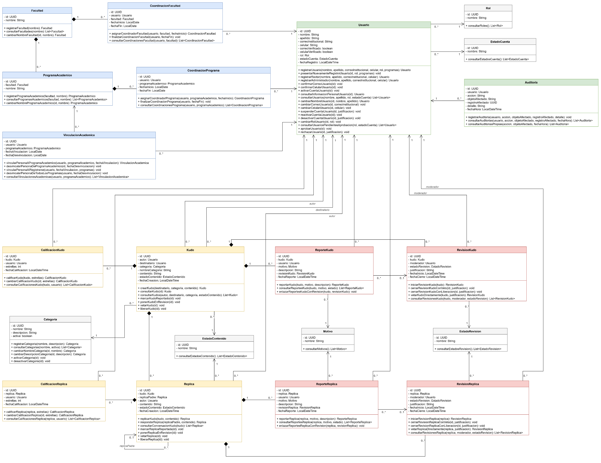

# 📐 Diagrama de clases

[🏠 Inicio](../../README.md) · [🧩 Modelo de dominio](../modelo-dominio/README.md) · [🗄️ MER](../mer/README.md)

Diseño UML de las clases de dominio. Cada clase tiene su página con relaciones, atributos, constructores, accesores y métodos de negocio con sus excepciones.

| Clases | Atributos | Métodos de negocio | Extremos de relación |
| :---: | :---: | :---: | :---: |
| 21 | 104 | 86 | 72 |

## Diagrama

> Colores por área: 🟦 Estructura académica · 🟩 Usuarios y auditoría · 🟨 Reconocimientos y conversación · 🟥 Moderación · ⬜ Catálogos.

## Clases por área

### Catálogos

| Clase | Descripción | Atributos | Métodos |
| --- | --- | :---: | :---: |
| [**Rol**](Rol.md) | Catálogo de roles institucionales. Un usuario tiene exactamente un rol activo y los roles son mutuamente excluyentes, es decir que un usuario no puede tener más de un rol. | 2 | 1 |
| [**EstadoCuenta**](EstadoCuenta.md) | Catálogo de estados de la cuenta de un usuario. Una cuenta Aprobada aún no está Activa hasta validar correo y celular. | 2 | 1 |
| [**EstadoContenido**](EstadoContenido.md) | Catálogo de estados del ciclo de vida de un Kudo o de una Réplica. | 2 | 1 |
| [**EstadoRevision**](EstadoRevision.md) | Catálogo de estados de una revisión de moderación: en curso o cerrada con el contenido vetado o liberado. | 2 | 1 |
| [**Motivo**](Motivo.md) | Catálogo de motivos por los que un usuario reporta un Kudo o una Réplica. | 2 | 1 |
| [**Categoria**](Categoria.md) | Clasificación institucional de los Kudos. La gestionan Administrador, Rector y Coordinador Académico; una categoría inactiva no se usa en nuevos Kudos. | 4 | 6 |

### Estructura académica

| Clase | Descripción | Atributos | Métodos |
| --- | --- | :---: | :---: |
| [**Facultad**](Facultad.md) | Unidad académica que agrupa Programas Académicos. Puede existir sin programas solo mientras se crea. | 2 | 3 |
| [**ProgramaAcademico**](ProgramaAcademico.md) | Unidad académica que pertenece exactamente a una Facultad y en la que se vinculan estudiantes y docentes. | 3 | 3 |
| [**CoordinacionFacultad**](CoordinacionFacultad.md) | Historial de quién coordina cada Facultad. Solo una coordinación vigente por facultad y su reemplazo queda registrado. | 5 | 3 |
| [**CoordinacionPrograma**](CoordinacionPrograma.md) | Historial de quién coordina cada Programa Académico. Solo una coordinación vigente por programa. | 5 | 3 |
| [**VinculacionAcademica**](VinculacionAcademica.md) | Vínculo de un estudiante o docente con un Programa Académico. Una persona puede estar en varios programas y la desvinculación conserva el historial. | 5 | 5 |

### Usuarios y auditoría

| Clase | Descripción | Atributos | Métodos |
| --- | --- | :---: | :---: |
| [**Usuario**](Usuario.md) | Persona de la comunidad universitaria registrada en la plataforma con un rol institucional. Su cuenta solo está activa si fue aprobada y validó correo y celular. La aprobación o el rechazo de su registro lo decide la autoridad que corresponde a su rol; queda en el estado de la cuenta y en la Auditoría. | 10 | 19 |
| [**Auditoria**](Auditoria.md) | Registro histórico, de solo lectura, de cada acción relevante: quién la hizo, qué hizo, sobre qué registro y cuándo. Se puede consultar. | 7 | 3 |

### Reconocimientos y conversación

| Clase | Descripción | Atributos | Métodos |
| --- | --- | :---: | :---: |
| [**Kudo**](Kudo.md) | Reconocimiento formal que una persona otorga a otra de la comunidad universitaria, clasificado en una categoría y visible para la comunidad autenticada. | 8 | 7 |
| [**Replica**](Replica.md) | Intervención dentro de la conversación de un Kudo. Puede responder directamente al Kudo o a otra réplica, sin límite de profundidad y sin ciclos. | 7 | 7 |
| [**CalificacionKudo**](CalificacionKudo.md) | Valoración de 1 a 5 estrellas que una persona da a el Kudo. Cada persona tiene una sola calificación por Kudo y puede modificarla. | 5 | 3 |
| [**CalificacionReplica**](CalificacionReplica.md) | Valoración de 1 a 5 estrellas que una persona da a la réplica. Cada persona tiene una sola calificación por réplica y puede modificarla. | 5 | 3 |

### Moderación

| Clase | Descripción | Atributos | Métodos |
| --- | --- | :---: | :---: |
| [**RevisionKudo**](RevisionKudo.md) | Revisión de moderación sobre un Kudo, hecha por el Rector o el Coordinador Académico. Resuelve a la vez todos sus reportes y termina vetando o liberando el contenido; un veto directo es una revisión sin reportes. | 7 | 5 |
| [**RevisionReplica**](RevisionReplica.md) | Revisión de moderación sobre una réplica, hecha por el Rector o el Coordinador Académico. Resuelve a la vez todos sus reportes y termina vetando o liberando el contenido; un veto directo es una revisión sin reportes. | 7 | 5 |
| [**ReporteKudo**](ReporteKudo.md) | Solicitud de revisión que hace cualquier usuario autenticado sobre un Kudo, con un motivo. Se resuelve cuando la revisión del contenido se cierra. Su estado (Pendiente, En revisión, Aceptado o Rechazado) no se guarda: se deduce de la revisión que lo resuelve. | 7 | 3 |
| [**ReporteReplica**](ReporteReplica.md) | Solicitud de revisión que hace cualquier usuario autenticado sobre una réplica, con un motivo. Se resuelve cuando la revisión del contenido se cierra. Su estado (Pendiente, En revisión, Aceptado o Rechazado) no se guarda: se deduce de la revisión que lo resuelve. | 7 | 3 |

## Convenciones

| Elemento | Convención |
| --- | --- |
| Atributos | Siempre `private`, con getter y setter `public` |
| Valores por defecto | Ningún atributo queda en `null`: UUID vacío `new UUID(0L, 0L)`, texto `""`, fechas `LocalDate(Time).of(1000, 1, 1, …)` |
| Constructores | Uno por defecto y uno parametrizado con todos los atributos |
| Relaciones | **Necesita de**: la clase guarda una referencia a otra · **Es usada por**: otra clase la referencia |
| Excepciones | Cada método lista las políticas (`P-XXX-0000`) que pueden detener la operación y su mensaje |
