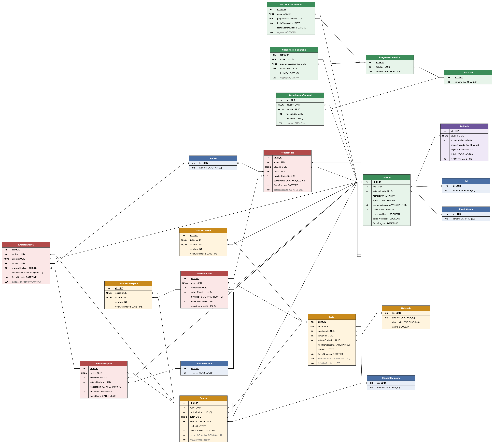

# 🗄️ Modelo Entidad-Relación (MER)

[🏠 Inicio](../../README.md) · [🧩 Modelo de dominio](../modelo-dominio/README.md) · [📐 Diagrama de clases](../clases/README.md)

Modelo de datos relacional derivado del modelo de dominio. Cada tabla tiene su página con columnas, llaves, restricciones, índices y campos calculados.

| Tablas | Columnas | Llaves foráneas | Campos calculados (vistas) |
| :---: | :---: | :---: | :---: |
| 21 | 104 | 36 | 9 |

## Diagrama

> **Convenciones del diagrama:** `PK` llave primaria · `FK` llave foránea · `UQ` participa en una restricción de unicidad · `VW` campo calculado en una vista · `(O)` columna opcional.

```mermaid
erDiagram
    Rol {
        UUID id PK
        VARCHAR nombre UK
    }
    EstadoCuenta {
        UUID id PK
        VARCHAR nombre UK
    }
    EstadoContenido {
        UUID id PK
        VARCHAR nombre UK
    }
    EstadoRevision {
        UUID id PK
        VARCHAR nombre UK
    }
    Motivo {
        UUID id PK
        VARCHAR nombre UK
    }
    Categoria {
        UUID id PK
        VARCHAR nombre UK
        VARCHAR descripcion
        BOOLEAN activa
    }
    Facultad {
        UUID id PK
        VARCHAR nombre UK
    }
    Usuario {
        UUID id PK
        UUID rol FK
        UUID estadoCuenta FK
        VARCHAR nombre
        VARCHAR apellido
        VARCHAR correoInstitucional UK
        VARCHAR celular UK
        BOOLEAN correoVerificado
        BOOLEAN celularVerificado
        DATETIME fechaRegistro
    }
    ProgramaAcademico {
        UUID id PK
        UUID facultad FK
        VARCHAR nombre UK
    }
    Auditoria {
        UUID id PK
        UUID usuario FK, UK
        VARCHAR accion UK
        VARCHAR objetoAfectado
        UUID registroAfectado
        VARCHAR detalle
        DATETIME fechaHora UK
    }
    CoordinacionFacultad {
        UUID id PK
        UUID usuario FK, UK
        UUID facultad FK, UK
        DATE fechaInicio UK
        DATE fechaFin
    }
    CoordinacionPrograma {
        UUID id PK
        UUID usuario FK, UK
        UUID programaAcademico FK, UK
        DATE fechaInicio UK
        DATE fechaFin
    }
    VinculacionAcademica {
        UUID id PK
        UUID usuario FK, UK
        UUID programaAcademico FK, UK
        DATE fechaVinculacion UK
        DATE fechaDesvinculacion
    }
    Kudo {
        UUID id PK
        UUID autor FK, UK
        UUID destinatario FK
        UUID categoria FK
        UUID estadoContenido FK
        VARCHAR nombreCategoria
        TEXT contenido
        DATETIME fechaCreacion UK
    }
    Replica {
        UUID id PK
        UUID kudo FK
        UUID replicaPadre FK
        UUID autor FK, UK
        UUID estadoContenido FK
        TEXT contenido
        DATETIME fechaCreacion UK
    }
    CalificacionKudo {
        UUID id PK
        UUID kudo FK, UK
        UUID usuario FK, UK
        INT estrellas
        DATETIME fechaCalificacion
    }
    RevisionKudo {
        UUID id PK
        UUID kudo FK, UK
        UUID moderador FK
        UUID estadoRevision FK
        VARCHAR justificacion
        DATETIME fechaInicio UK
        DATETIME fechaCierre
    }
    CalificacionReplica {
        UUID id PK
        UUID replica FK, UK
        UUID usuario FK, UK
        INT estrellas
        DATETIME fechaCalificacion
    }
    RevisionReplica {
        UUID id PK
        UUID replica FK, UK
        UUID moderador FK
        UUID estadoRevision FK
        VARCHAR justificacion
        DATETIME fechaInicio UK
        DATETIME fechaCierre
    }
    ReporteKudo {
        UUID id PK
        UUID kudo FK
        UUID usuario FK, UK
        UUID motivo FK
        UUID revisionKudo FK
        VARCHAR descripcion
        DATETIME fechaReporte UK
    }
    ReporteReplica {
        UUID id PK
        UUID replica FK
        UUID usuario FK, UK
        UUID motivo FK
        UUID revisionReplica FK
        VARCHAR descripcion
        DATETIME fechaReporte UK
    }
    Rol ||--o{ Usuario : "rol"
    EstadoCuenta ||--o{ Usuario : "estadoCuenta"
    Facultad ||--o{ ProgramaAcademico : "facultad"
    Usuario ||--o{ Auditoria : "usuario"
    Usuario ||--o{ CoordinacionFacultad : "usuario"
    Facultad ||--o{ CoordinacionFacultad : "facultad"
    Usuario ||--o{ CoordinacionPrograma : "usuario"
    ProgramaAcademico ||--o{ CoordinacionPrograma : "programaAcademico"
    Usuario ||--o{ VinculacionAcademica : "usuario"
    ProgramaAcademico ||--o{ VinculacionAcademica : "programaAcademico"
    Usuario ||--o{ Kudo : "autor"
    Usuario ||--o{ Kudo : "destinatario"
    Categoria ||--o{ Kudo : "categoria"
    EstadoContenido ||--o{ Kudo : "estadoContenido"
    Kudo ||--o{ Replica : "kudo"
    Replica o|--o{ Replica : "replicaPadre"
    Usuario ||--o{ Replica : "autor"
    EstadoContenido ||--o{ Replica : "estadoContenido"
    Kudo ||--o{ CalificacionKudo : "kudo"
    Usuario ||--o{ CalificacionKudo : "usuario"
    Kudo ||--o{ RevisionKudo : "kudo"
    Usuario ||--o{ RevisionKudo : "moderador"
    EstadoRevision ||--o{ RevisionKudo : "estadoRevision"
    Replica ||--o{ CalificacionReplica : "replica"
    Usuario ||--o{ CalificacionReplica : "usuario"
    Replica ||--o{ RevisionReplica : "replica"
    Usuario ||--o{ RevisionReplica : "moderador"
    EstadoRevision ||--o{ RevisionReplica : "estadoRevision"
    Kudo ||--o{ ReporteKudo : "kudo"
    Usuario ||--o{ ReporteKudo : "usuario"
    Motivo ||--o{ ReporteKudo : "motivo"
    RevisionKudo o|--o{ ReporteKudo : "revisionKudo"
    Replica ||--o{ ReporteReplica : "replica"
    Usuario ||--o{ ReporteReplica : "usuario"
    Motivo ||--o{ ReporteReplica : "motivo"
    RevisionReplica o|--o{ ReporteReplica : "revisionReplica"
```

<b>Ver el MER interactivo (Mermaid)</b>

## Tablas

| Tabla | Área | Descripción | Columnas | FK | Vistas |
| --- | --- | --- | :---: | :---: | :---: |
| [**Rol**](Rol.md) | Catálogos | Catálogo de roles institucionales. Un usuario tiene exactamente un rol activo y los roles son mutuamente excluyentes, es decir que un usuario no puede tener más de un rol. | 2 | 0 | 0 |
| [**EstadoCuenta**](EstadoCuenta.md) | Catálogos | Catálogo de estados de la cuenta de un usuario. Una cuenta Aprobada aún no está Activa hasta validar correo y celular. | 2 | 0 | 0 |
| [**EstadoContenido**](EstadoContenido.md) | Catálogos | Catálogo de estados del ciclo de vida de un Kudo o de una Réplica. | 2 | 0 | 0 |
| [**EstadoRevision**](EstadoRevision.md) | Catálogos | Catálogo de estados de una revisión de moderación: en curso o cerrada con el contenido vetado o liberado. | 2 | 0 | 0 |
| [**Motivo**](Motivo.md) | Catálogos | Catálogo de motivos por los que un usuario reporta un Kudo o una Réplica. | 2 | 0 | 0 |
| [**Categoria**](Categoria.md) | Catálogos | Clasificación institucional de los Kudos. La gestionan Administrador, Rector y Coordinador Académico; una categoría inactiva no se usa en nuevos Kudos. | 4 | 0 | 0 |
| [**Facultad**](Facultad.md) | Estructura académica | Unidad académica que agrupa Programas Académicos. Puede existir sin programas solo mientras se crea. | 2 | 0 | 0 |
| [**Usuario**](Usuario.md) | Usuarios y auditoría | Persona de la comunidad universitaria registrada en la plataforma con un rol institucional. Su cuenta solo está activa si fue aprobada y validó correo y celular. La aprobación o el rechazo de su registro lo decide la autoridad que corresponde a su rol; queda en el estado de la cuenta y en la Auditoría. | 10 | 2 | 0 |
| [**ProgramaAcademico**](ProgramaAcademico.md) | Estructura académica | Unidad académica que pertenece exactamente a una Facultad y en la que se vinculan estudiantes y docentes. | 3 | 1 | 0 |
| [**Auditoria**](Auditoria.md) | Usuarios y auditoría | Registro histórico, de solo lectura, de cada acción relevante: quién la hizo, qué hizo, sobre qué registro y cuándo. Se puede consultar. | 7 | 1 | 0 |
| [**CoordinacionFacultad**](CoordinacionFacultad.md) | Estructura académica | Historial de quién coordina cada Facultad. Solo una coordinación vigente por facultad y su reemplazo queda registrado. | 5 | 2 | 1 |
| [**CoordinacionPrograma**](CoordinacionPrograma.md) | Estructura académica | Historial de quién coordina cada Programa Académico. Solo una coordinación vigente por programa. | 5 | 2 | 1 |
| [**VinculacionAcademica**](VinculacionAcademica.md) | Estructura académica | Vínculo de un estudiante o docente con un Programa Académico. Una persona puede estar en varios programas y la desvinculación conserva el historial. | 5 | 2 | 1 |
| [**Kudo**](Kudo.md) | Reconocimientos y conversación | Reconocimiento formal que una persona otorga a otra de la comunidad universitaria, clasificado en una categoría y visible para la comunidad autenticada. | 8 | 4 | 2 |
| [**Replica**](Replica.md) | Reconocimientos y conversación | Intervención dentro de la conversación de un Kudo. Puede responder directamente al Kudo o a otra réplica, sin límite de profundidad y sin ciclos. | 7 | 4 | 2 |
| [**CalificacionKudo**](CalificacionKudo.md) | Reconocimientos y conversación | Valoración de 1 a 5 estrellas que una persona da a el Kudo. Cada persona tiene una sola calificación por Kudo y puede modificarla. | 5 | 2 | 0 |
| [**RevisionKudo**](RevisionKudo.md) | Moderación | Revisión de moderación sobre un Kudo, hecha por el Rector o el Coordinador Académico. Resuelve a la vez todos sus reportes y termina vetando o liberando el contenido; un veto directo es una revisión sin reportes. | 7 | 3 | 0 |
| [**CalificacionReplica**](CalificacionReplica.md) | Reconocimientos y conversación | Valoración de 1 a 5 estrellas que una persona da a la réplica. Cada persona tiene una sola calificación por réplica y puede modificarla. | 5 | 2 | 0 |
| [**RevisionReplica**](RevisionReplica.md) | Moderación | Revisión de moderación sobre una réplica, hecha por el Rector o el Coordinador Académico. Resuelve a la vez todos sus reportes y termina vetando o liberando el contenido; un veto directo es una revisión sin reportes. | 7 | 3 | 0 |
| [**ReporteKudo**](ReporteKudo.md) | Moderación | Solicitud de revisión que hace cualquier usuario autenticado sobre un Kudo, con un motivo. Se resuelve cuando la revisión del contenido se cierra. Su estado (Pendiente, En revisión, Aceptado o Rechazado) no se guarda: se deduce de la revisión que lo resuelve. | 7 | 4 | 1 |
| [**ReporteReplica**](ReporteReplica.md) | Moderación | Solicitud de revisión que hace cualquier usuario autenticado sobre una réplica, con un motivo. Se resuelve cuando la revisión del contenido se cierra. Su estado (Pendiente, En revisión, Aceptado o Rechazado) no se guarda: se deduce de la revisión que lo resuelve. | 7 | 4 | 1 |

## Tipos de dato usados

| Tipo | Uso |
| --- | --- |
| `UUID` | Identificadores y llaves foráneas (los genera la aplicación, no son autoincrementales) |
| `VARCHAR(n)` | Textos con longitud máxima |
| `TEXT` | Textos sin límite (contenido de Kudos y réplicas) |
| `INT` / `DECIMAL` | Números enteros y decimales |
| `BOOLEAN` | Indicadores Sí/No |
| `DATE` / `DATETIME` | Fechas y fechas con hora |
