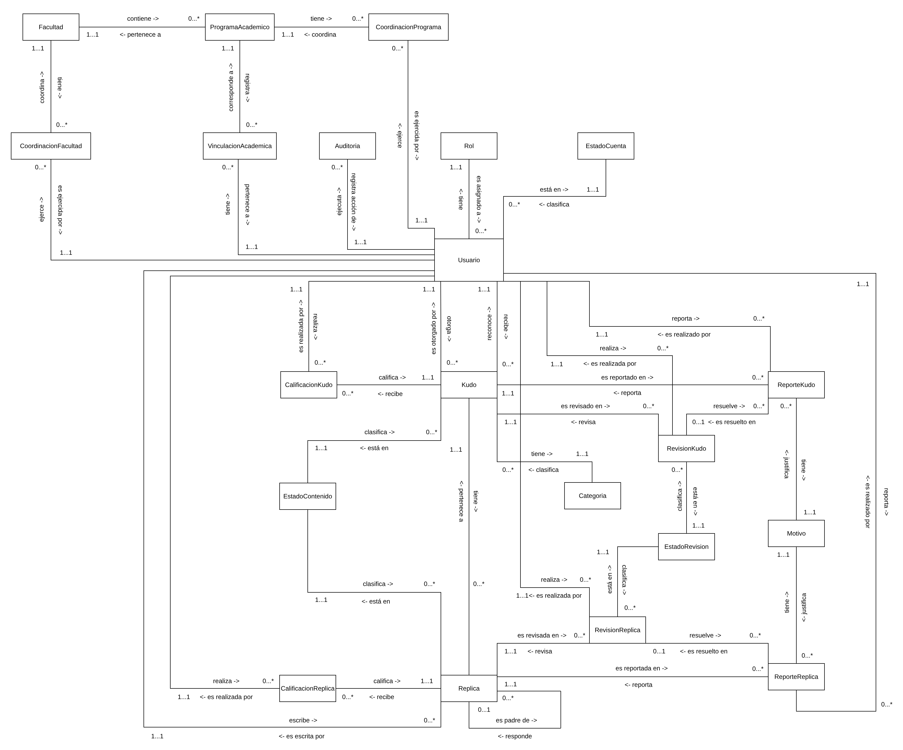

# 🧩 Modelo de dominio

[🏠 Inicio](../../README.md) · [🗄️ MER](../mer/README.md) · [📐 Diagrama de clases](../clases/README.md)

Modelo de dominio de UCO Kudos construido con **Domain Driven Design**. Cada objeto tiene su propia página con cinco partes: **muestreo**, **caracterización**, **responsabilidades**, **event storming** y **políticas**.

| Objetos | Atributos | Responsabilidades | Eventos | Políticas |
| :---: | :---: | :---: | :---: | :---: |
| 21 | 104 | 86 | 86 | 202 |

## Diagrama

> Haz clic en la imagen para verla en tamaño completo.

## Objetos de dominio

Ordenados por **línea de vida**: un objeto de un nivel solo depende de objetos de niveles anteriores.

| Objeto | Nivel | Descripción | Atrib. | Resp. | Eventos | Políticas |
| --- | :---: | --- | :---: | :---: | :---: | :---: |
| [**Rol**](Rol.md) | 1 | Catálogo de roles institucionales. Un usuario tiene exactamente un rol activo y los roles son mutuamente excluyentes, es decir que un usuario no puede tener más de un rol. | 2 | 1 | 1 | 1 |
| [**EstadoCuenta**](EstadoCuenta.md) | 1 | Catálogo de estados de la cuenta de un usuario. Una cuenta Aprobada aún no está Activa hasta validar correo y celular. | 2 | 1 | 1 | 1 |
| [**EstadoContenido**](EstadoContenido.md) | 1 | Catálogo de estados del ciclo de vida de un Kudo o de una Réplica. | 2 | 1 | 1 | 1 |
| [**EstadoRevision**](EstadoRevision.md) | 1 | Catálogo de estados de una revisión de moderación: en curso o cerrada con el contenido vetado o liberado. | 2 | 1 | 1 | 1 |
| [**Motivo**](Motivo.md) | 1 | Catálogo de motivos por los que un usuario reporta un Kudo o una Réplica. | 2 | 1 | 1 | 1 |
| [**Categoria**](Categoria.md) | 1 | Clasificación institucional de los Kudos. La gestionan Administrador, Rector y Coordinador Académico; una categoría inactiva no se usa en nuevos Kudos. | 4 | 6 | 6 | 10 |
| [**Facultad**](Facultad.md) | 1 | Unidad académica que agrupa Programas Académicos. Puede existir sin programas solo mientras se crea. | 2 | 3 | 3 | 4 |
| [**Usuario**](Usuario.md) | 2 | Persona de la comunidad universitaria registrada en la plataforma con un rol institucional. Su cuenta solo está activa si fue aprobada y validó correo y celular. La aprobación o el rechazo de su registro lo decide la autoridad que corresponde a su rol; queda en el estado de la cuenta y en la Auditoría. | 10 | 19 | 19 | 51 |
| [**ProgramaAcademico**](ProgramaAcademico.md) | 2 | Unidad académica que pertenece exactamente a una Facultad y en la que se vinculan estudiantes y docentes. | 3 | 3 | 3 | 5 |
| [**Auditoria**](Auditoria.md) | 3 | Registro histórico, de solo lectura, de cada acción relevante: quién la hizo, qué hizo, sobre qué registro y cuándo. Se puede consultar. | 7 | 3 | 3 | 8 |
| [**CoordinacionFacultad**](CoordinacionFacultad.md) | 3 | Historial de quién coordina cada Facultad. Solo una coordinación vigente por facultad y su reemplazo queda registrado. | 5 | 3 | 3 | 7 |
| [**CoordinacionPrograma**](CoordinacionPrograma.md) | 3 | Historial de quién coordina cada Programa Académico. Solo una coordinación vigente por programa. | 5 | 3 | 3 | 9 |
| [**VinculacionAcademica**](VinculacionAcademica.md) | 3 | Vínculo de un estudiante o docente con un Programa Académico. Una persona puede estar en varios programas y la desvinculación conserva el historial. | 5 | 5 | 5 | 9 |
| [**Kudo**](Kudo.md) | 3 | Reconocimiento formal que una persona otorga a otra de la comunidad universitaria, clasificado en una categoría y visible para la comunidad autenticada. | 8 | 7 | 7 | 19 |
| [**Replica**](Replica.md) | 4 | Intervención dentro de la conversación de un Kudo. Puede responder directamente al Kudo o a otra réplica, sin límite de profundidad y sin ciclos. | 7 | 7 | 7 | 19 |
| [**CalificacionKudo**](CalificacionKudo.md) | 4 | Valoración de 1 a 5 estrellas que una persona da a el Kudo. Cada persona tiene una sola calificación por Kudo y puede modificarla. | 5 | 3 | 3 | 9 |
| [**RevisionKudo**](RevisionKudo.md) | 4 | Revisión de moderación sobre un Kudo, hecha por el Rector o el Coordinador Académico. Resuelve a la vez todos sus reportes y termina vetando o liberando el contenido; un veto directo es una revisión sin reportes. | 7 | 5 | 5 | 11 |
| [**CalificacionReplica**](CalificacionReplica.md) | 5 | Valoración de 1 a 5 estrellas que una persona da a la réplica. Cada persona tiene una sola calificación por réplica y puede modificarla. | 5 | 3 | 3 | 9 |
| [**RevisionReplica**](RevisionReplica.md) | 5 | Revisión de moderación sobre una réplica, hecha por el Rector o el Coordinador Académico. Resuelve a la vez todos sus reportes y termina vetando o liberando el contenido; un veto directo es una revisión sin reportes. | 7 | 5 | 5 | 11 |
| [**ReporteKudo**](ReporteKudo.md) | 5 | Solicitud de revisión que hace cualquier usuario autenticado sobre un Kudo, con un motivo. Se resuelve cuando la revisión del contenido se cierra. Su estado (Pendiente, En revisión, Aceptado o Rechazado) no se guarda: se deduce de la revisión que lo resuelve. | 7 | 3 | 3 | 8 |
| [**ReporteReplica**](ReporteReplica.md) | 6 | Solicitud de revisión que hace cualquier usuario autenticado sobre una réplica, con un motivo. Se resuelve cuando la revisión del contenido se cierra. Su estado (Pendiente, En revisión, Aceptado o Rechazado) no se guarda: se deduce de la revisión que lo resuelve. | 7 | 3 | 3 | 8 |

## Prefijos de las políticas

Las políticas se numeran `P-XXX-0000`, donde `XXX` identifica al objeto responsable.

| Prefijo | Objeto |
| --- | --- |
| `P-ROL` | [Rol](Rol.md#5-políticas) |
| `P-MOT` | [Motivo](Motivo.md#5-políticas) |
| `P-CAT` | [Categoria](Categoria.md#5-políticas) |
| `P-FAC` | [Facultad](Facultad.md#5-políticas) |
| `P-USU` | [Usuario](Usuario.md#5-políticas) |
| `P-PRO` | [ProgramaAcademico](ProgramaAcademico.md#5-políticas) |
| `P-AUD` | [Auditoria](Auditoria.md#5-políticas) |
| `P-COF` | [CoordinacionFacultad](CoordinacionFacultad.md#5-políticas) |
| `P-COP` | [CoordinacionPrograma](CoordinacionPrograma.md#5-políticas) |
| `P-VIN` | [VinculacionAcademica](VinculacionAcademica.md#5-políticas) |
| `P-KUD` | [Kudo](Kudo.md#5-políticas) |
| `P-REP` | [Replica](Replica.md#5-políticas) |
| `P-CAK` | [CalificacionKudo](CalificacionKudo.md#5-políticas) |
| `P-RVK` | [RevisionKudo](RevisionKudo.md#5-políticas) |
| `P-CAR` | [CalificacionReplica](CalificacionReplica.md#5-políticas) |
| `P-RVR` | [RevisionReplica](RevisionReplica.md#5-políticas) |
| `P-RPK` | [ReporteKudo](ReporteKudo.md#5-políticas) |
| `P-RPR` | [ReporteReplica](ReporteReplica.md#5-políticas) |

## Convenciones del muestreo

| Elemento | Significado |
| --- | --- |
| `id` | Identificador único del objeto |
| Atributo cuyo tipo es otro objeto | Referencia a otro objeto de dominio (se muestra con su dato más legible) |
| Dato que ingresa o selecciona el actor | Lo aporta quien ejecuta la acción |
| Dato que asigna o genera el sistema | Fechas, estados iniciales, identificadores |
| Combinación única | Atributos que juntos no se pueden repetir |
| Fecha de fin vacía | El registro sigue vigente |
